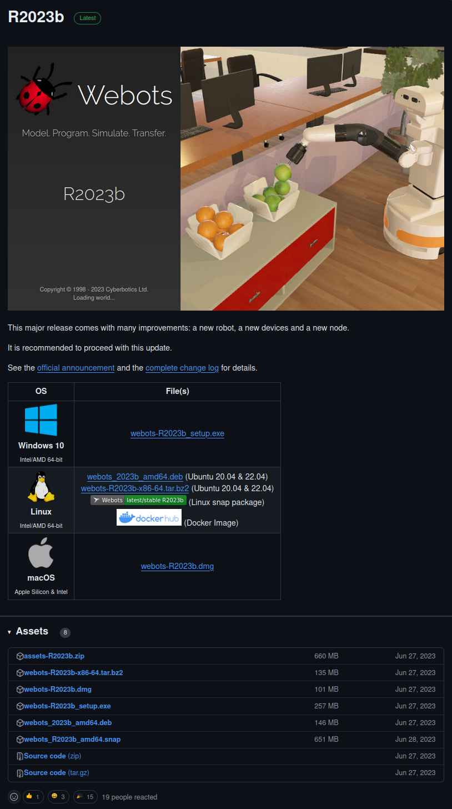
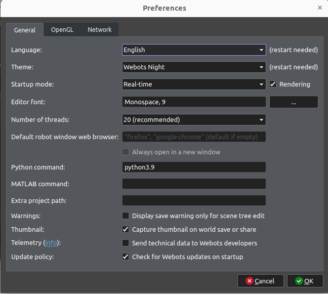

# UAV_Follow_Env
## Environment Preperation(ubuntu desktop)
### Download Webots
Github: https://github.com/cyberbotics/webots/releases


Download webots and extract them to /opt
```bash
sudo tar -jxvf webots-R2023b-x86-64.tar.bz2 -C /opt
```
Add dynamic library path to ~/.bashrc
```bash
export LD_LIBRARY_PATH=$LD_LIBRARY_PATH:/opt/webots/lib/webots
```
Then try to open webots by:
```bash
cd /opt/webots/bin
./webots-bin
```
Download the assets file for webots and copy it to the specified path.
```bash
sudo cp -r cache/ ~/.cache/Cyberbotics/Webots/assets
```
- Webots OpenGL using nvidia
```bash
sudo prime-select nvidia
```

### Algorithm and simulation environment
#### Creating a Virtual Environment
```bash
conda create -n uav_follow39 python=3.9
```
#### Algorithmic Requirement
```bash
pip install torch==2.2.0 torchvision==0.17.0 torchaudio==2.2.0 --index-url https://download.pytorch.org/whl/cu121
pip install opencv-python==4.9.0.80
pip install gym==0.25.1
pip install setproctitle==1.3.3
pip install tensorboard
```
#### Simulation requirement
```bash
sudo apt-get install libeigen3-dev
sudo apt-get install nlohmann-json3-dev

sudo apt install sumo sumo-tools sumo-doc
pip install lxml pyproj shapely webcolors configparser --user
```

- Putting webots and sumo root paths into global references
```bash
sudo nano ~/.bashrc
# 在末行加入一下路径(如果有不同需要更改路径)
export SUMO_HOME=/usr/share/sumo
export WEBOTS_HOME=/opt/webots
# 在设置路径之后需要重启ubuntu系统才能正常生效
```

- Changing the python execution environment in webots

    In order for Webots to use Anaconda's virtual environment, we create a new soft connection link to the virtual environment's python.
    
    For example, if our virtual environment's python path is **/home/username/anaconda3/envs/envname/bin/python3.9**, then we just need to create a soft connection under **/usr/bin/** to **/home/username/anaconda3/envs/envname/bin/python3.9**：

    ```bash
    sudo ln -s /home/username/anaconda3/envs/envname/bin/python3.9 /usr/bin/python3.9
    ```

    At this point, you can exit the virtual environment environment at the terminal and enter:

    ```bash
    python3.9
    ```

    You can verify that the version of python in the conda base environment is the same as the version of python in the conda base environment.
    At this point, Webots can normally use the packages in the conda base environment.

    It is important to note that the creation of a softwire does not need to overwrite the existing python or python3 softwire, otherwise it will lead to problems such as the terminal not being able to open.

    **Finally, you need to configure the Python interpreter options for Webots.**
    
    
    Just change the Python command entry to the name of the soft connection you just created, python3.9.
