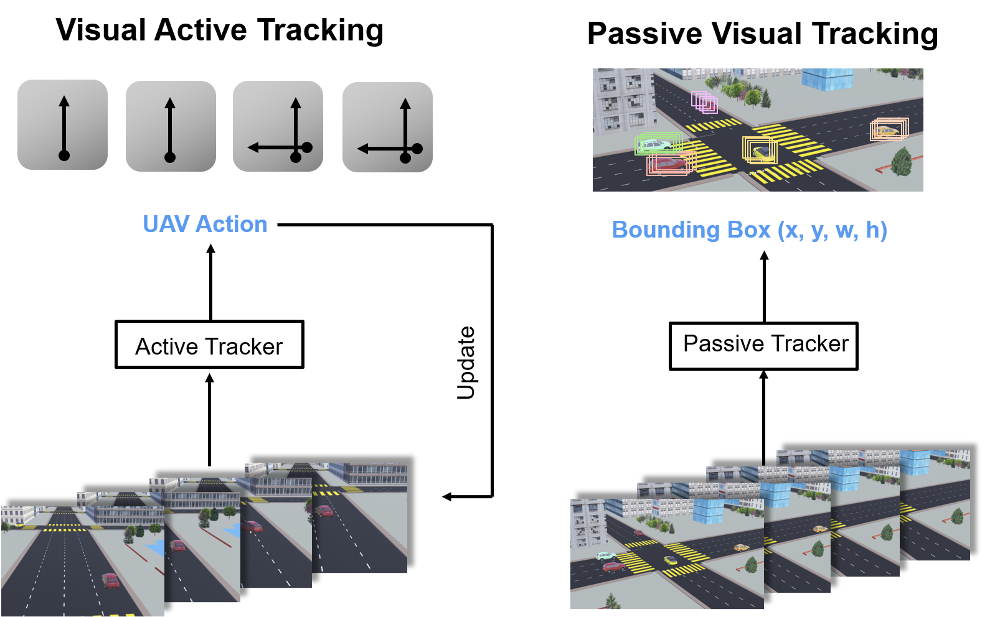
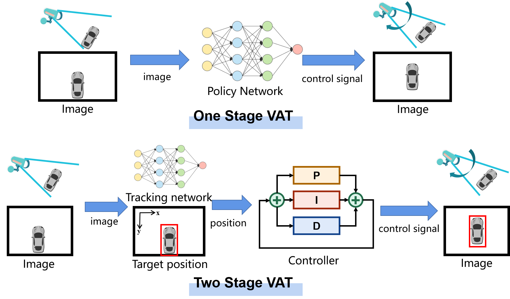
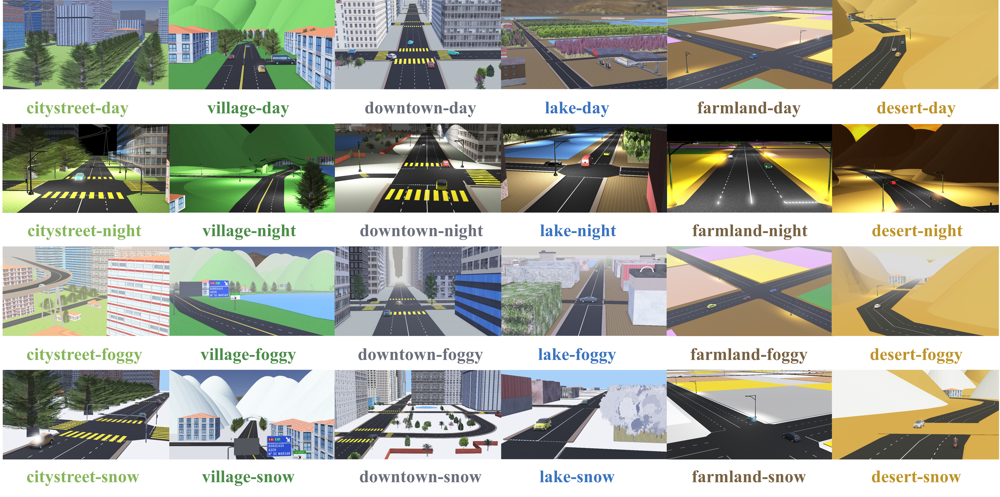
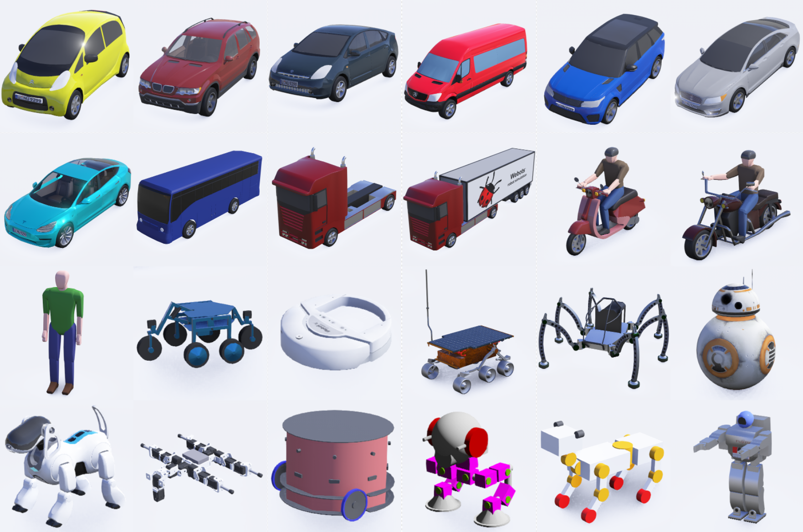
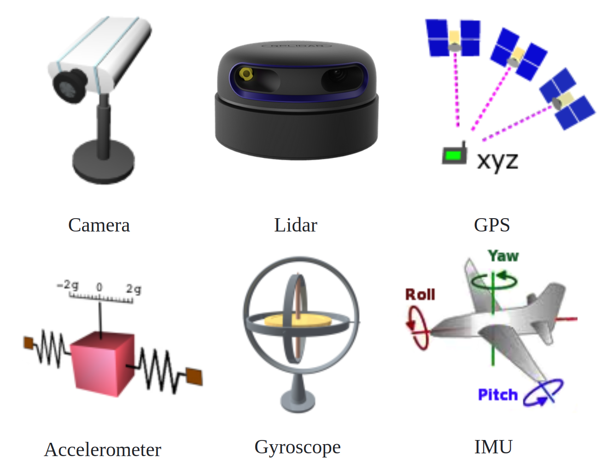

Overview
=================

.. raw:: html

    

    <!-- Language switch buttons -->
    

        <b style="font-size: 18px;">You can choose language by </b>
        <button onclick="switchLanguage('zh')">中文</button>
        <button onclick="switchLanguage('en')">English</button>
    

    
     
    

     
     

1 Visual Active Tracking
------------------------------------

VAT Task
~~~~~~~~~~~~~~~~~~~~~~~~~~~~~~~~~~~~

* **Real-world Task**: A real-world visual task where the target exhibits high dynamic characteristics. The main challenge is actively controlling the camera to improve visual accuracy.
* **Existing Methods**: Existing PVT (Passive Visual Tracking) methods are based on the assumption that the target remains within a preset frame, only tracking in the video dimension.
* **VAT Task**: VAT (Visual Active Tracking) simultaneously models visual tracking and control, achieving active camera control to track dynamic targets, making it more realistic.

   Differences between VAT Tasks and PVT Settings

.. raw:: html

     

VAT Scheme
~~~~~~~~~~~~~~~~~~~~~~~~~~~~~~~~~~~~

* **Existing VAT Scheme**: Directly connect the VT model and the control model for VAT (e.g., siamask+PID)

   **Limitation 1**: The visual model requires a lot of manual labeling

   **Limitation 2**: The control model is sensitive to parameters and requires parameter fine-tuning for each different scenario

* **This Project's VAT Scheme**: Use MDP (Markov Decision Process) to model both visual and control tasks simultaneously, solving visual and control tasks with a single model

   **Advantage**: End-to-end RL is more efficient and better suited for cross-scenario tasks

   Single-Stage and Two-Stage VAT Scheme Illustration

2 Benchmark Presentation
------------------------------------

* **Diversity**：

   * **Scenario Diversity**: Equipped with 6 scenarios and 4 weather conditions, totaling 24 environments

   * **Target Diversity**: Preset 24 selectable targets, supporting the integration of custom models

   * **Task Diversity**: Equipped with 6 common vision and motion sensors

* **Complexity**：

   * **Complex Scene Elements**: The scene elements are complex, covering common elements such as tree occlusion, tunnels, traffic lights, sidewalks, etc.

   * **Complex Dynamic Models**: Utilizing Webots' highly realistic dynamic engine to achieve dynamic simulation in the virtual environment

   * **Complex Target Behavior Management**: Integrating the traffic simulator SUMO for unified vehicle management, ensuring the realism and randomness of Target actions in the environment

Diverse Simulation Scenarios
~~~~~~~~~~~~~~~~~~~~~~~~~~~~~~~~~~~~

For detailed scenarios, see: :ref:`Environment Introduction`

   24 Complex Scene Examples

Diverse Tracking Targets
~~~~~~~~~~~~~~~~~~~~~~~~~~~~~~~~~~~~

For details on tracking target objects, see: :ref:`Tracked Objects`

   24 Different Targets

Diverse Tasks
~~~~~~~~~~~~~~~~~~~~~~~~~~~~~~~~~~~~

* **Task Diversity**: The state provides sensors commonly found in real-world scenarios, such as IMU, accelerometer, gyroscope, LiDAR, etc.

For diverse task configurations, see: :ref:`customized parameter interface`

   6 Common Sensors
