仿真环境
=======================

环境介绍
----------

- 该项目的仿真环境基于开源仿真软件webots搭建，仿真环境的背景是模拟现实生活中在室外场景中的目标追踪问题。为此，设立了包括城市街道、市中心、湖边、乡村、沙漠、农田共六张地图，其中每张地图演化出白天、夜晚、雾天、雪天等，总共24个环境。为了方便模型训练从简单的环境开始，还设置了几张简单的环境地图可供使用。
- 该项目24个仿真环境示意图：

   .. image:: ../_static/image/24Scene_Colorful2.png
      :alt: 24个环境示意图
      :width: 600px
      :align: center

.. _运行流程:

运行流程
----------

   .. image:: ../_static/image/运行流程.png
      :alt: 仿真环境运行流程示意图
      :width: 600px
      :align: center

demo模式
~~~~~~~~~

   该模式在地图中生成一个无人机。可以通过键盘操作无人机在地图中飞行，浏览地图。同时该无人机默认跟踪其初始位置附近的一辆BmwX5车辆，并实时把reward参数输出在Console状态栏。可以用该对象测试内置reward参数是否合理，进行调试。

video模式
~~~~~~~~~~

   - 该模式主要用于记录被跟踪对象的行为。环境将自动调度无人机误差跟踪对象，并且按照仿真时间和配置参数导出视频图像，同时生成对应每张图像的标签。
   - 数据存储的位置为： :code:`./Webots_Simulation/traffic_project/droneVideos/DRONEX/episodeX` ，图像格式为jpeg，标签为 :code:`mark.json` 文件。
   - 同时还可以通过脚本生成多组视频图像的文件结构描述，直接执行 :code:`./Webots_Simulation/traffic_project/fileStruct.py` 脚本，在相同目录下生成描述文件 :code:`dir_info.json`。

train模式
~~~~~~~~~~

   该模式用于算法的训练，可以选择先手动打开webots仿真，再运行训练脚本，也可以选择通过修改算法端配置文件实现算法一键全启动。

参数配置
-----------

   仿真环境的配置文件为 :code:`UAV_Follow_Env/Webots_Simulation/traffic_project/config/env_config.json`。

基础参数
~~~~~~~~~~~

.. code:: json

   {
      "Simulation_Mode": "train",
      "Drone_Supervisor_Ctrl": false,
      "Socket_Ip": "127.0.0.1",
      "Config_Agen_Num_Port":7789,
      "Train_Total_Steps": 3000,
      "Init_No_Done_Steps": 100,
      "No_Reward_Done_Steps": 100,
      "Control_Frequence": 50,
      "Customized_Rewards": true,
      "Lidar_Enable": false,
      "Tracking_Object": "SUMO_VEHICLE"
   }

**参数说明**

   * :code:`Simulation_Mode` ：仿真模式有三种:"demo"、"video"、"train"。demo与video模式是仿真端自运行的模式（默认demo）。

      * demo会在地图中生成一个无人机，支持键盘直接控制，同时默认追踪地图中一辆静置车辆Bmx，可以通过该模式浏览地图或者调试reward参数。
      * video模式是视频拍摄模式，在该模式下无人机会自动跟踪目标对象，导出视频图像和标签。
      * train是训练模式，仿真端与算法端进行交互，对无人机的追踪算法进行训练。
      * 完整系统运行流程图见： :ref:`运行流程` 

   - :code:`Drone_Supervisor_Ctrl` ：是否使用supervisor控制无人机，supervisor是webots的超级管理员，可以直接控制任何节点。如果为true，则使用supervisor控制无人机，其所有的动作都是实时无差响应的，这有利于简化算法的训练。如果为false，则使用传统PID控制器控制无人机的运动。
   - :code:`Socket_Ip` ：socket通信的ip地址，如果为本机通信，默认 **"127.0.0.1"**。
   - :code:`Config_Agen_Num_Port` ：配置socket通信端口，该端口用于与算法端进行通信，以确定将要设置的无人机（智能体）数量。
   - :code:`Train_Total_Steps` ：训练的最大步长数，如果步长超出则返回done。
   - :code:`Init_No_Done_Steps` ：初始化没有done的仿真步长数，为了防止无人机在初始化的时候物理属性不稳定导致done状态的出发，因此设置该参数在合理大小内。
   - :code:`No_Reward_Done_Steps` ：连续reward为0时产生done状态的仿真步长。
   - :code:`Control_Frequence` ：控制算法控制频率。在进行训练时仿真端根据仿真时间进行500Hz的控制频率，该参数用于调整算法端的平均控制频率。

   * :code:`Customized_Rewards` ：是否启用定制化reward参数。用户可以根据定制化reward参数，自行计算reward。

      * 定制化Reward参数的详细内容见： :ref:`定制化参数接口` 
   * :code:`Lidar_Enable` ：是否启用雷达点云数据。

      * 雷达点云数据的详细内容见： :ref:`定制化参数接口` 
   * :code:`Tracking_Object` ：跟踪对象设置（默认SUMO_VEHICLE）。可以使用示例跟踪对象，包括“SUMO_VEHICLE”、“Pedestrian”、“Shrimp”、“Create”、“Sojourner”、“Mantis”等等。也可以自定义跟踪对象。项目说明书
      
      * 追踪对象类型的具体描述见： :ref:`追踪对象` 

无人机产生done的物理范围参数配置
~~~~~~~~~~~~~~~~~~~~~~~~~~~~~~~~~~~~~~~~~~

.. code:: json

   "Done_Range": {"127.0.0.1"
        "max_height": 50,
        "min_height": 2,
        "velocity": 100,
        "omiga": 6.283,
        "roll": 1.22,
        "pitch": 1.22,
        "distance_error": 50
   }

**参数说明**

   - :code:`max_height` ：无人机最大飞行高度（m）。
   - :code:`min_height` ：无人机最小飞行高度（m）。
   - :code:`velocity` ：无人机最大飞行速度（m/s）。
   - :code:`omiga` ：无人机最大飞行角速度（rad/s）。
   - :code:`roll` ：无人机最大飞行roll角度（rad）。
   - :code:`pitch` ：无人机最大飞行pitch角度（rad）。
   - :code:`distance_error` ：无人机期望位置和当前位置的最大误差（m）。

内置reward的参数配置
~~~~~~~~~~~~~~~~~~~~~~~~~~~~~~~~~~~~~~~~~~

.. code:: json

   "Reward_Config": {
        "reward_mode": "continuous",
        "distance_scale": 0.01,
        "reward_range": 7
   }

**参数说明**

   - :code:`reward_mode` ：默认reward的模式。continuous产生的是[0，1]之间的连续浮点数 ，而discrete产生的是0或1的整数。
   - :code:`distance_scale` ：距离比例（默认continuous）。该参数只对continuous模式有效，控制reward因距离误差而衰减的速度。

   * :code:`reward_range` ：产生reward的距离误差范围。
      
      * 具体参数含义见： :ref:`内置Reward` 

SUMO交通系统参数配置
~~~~~~~~~~~~~~~~~~~~~~~~~~~~~~~~~~~~~~~~~~

.. code:: json

   "Sumo_Params": {
        "max_sumo_car": 60,
        "car_import_interval": 60.0,
        "car_type": "passenger",
        "fixed_color": true,
        "normalize_color": [1,0,0],
        "max_car_speed": 15,
        "max_car_accel": 5,
        "max_car_decel": 5,
        "max_rou_distance": 8000,
        "min_rou_distance": 300,
        "route_num": 100000
   }

**参数说明**

   - :code:`max_sumo_car` ：地图中最大载具数量。
   - :code:`car_import_interval` ：加入地图每组载具的间隔时间（s）。

   * :code:`car_type` ：载具的类型（默认passenger），包括“passenger”、“bus”、“truck”、“trailer”、“motorcycle”。

      * 所有支持的载具类型见： :ref:`SUMO_VEHICLE`

   - :code:`fixed_color` ：是否固定载具颜色。
   - :code:`normalize_color` ：归一化的RGB颜色向量。
   - :code:`max_car_speed` ：最大载具移动速度（m/s）。
   - :code:`max_car_accel` ：最大载具加速度（m/s^2）。
   - :code:`max_car_decel` ：最大载具减速度（m/s^2）。
   - :code:`max_rou_distance` ：最大路径长度（m）。
   - :code:`min_rou_distance` ：最小路径长度（m）。
   - :code:`route_num` ：路径最大数量（注意是最大， :code:`obj_edge_distribution_multilateral` 实际由于随机化的过程不一定完全成功，会比设置的参数要少）。

其他对象追踪的参数配置
~~~~~~~~~~~~~~~~~~~~~~~~~~~~~~~~~~~~~~~~~~

.. code:: json

   "Other_Params": {
        "max_obj_num": 10,
        "obj_import_interval": 0.5,
        "import_group_num": 4,
        "obj_edge_distribution_random": false,
        "obj_edge_distribution_multilateral": false,
        "obj_edge_distribution_fixed": 0,
        "obj_edge_distribution_max":10,
        "obj_edge_distribution_min":-10

   }

**参数说明**

   - :code:`max_obj_num` ：最大对象数量。
   - :code:`obj_import_interval` ：每组对象加入地图的时间间隔（s）。
   - :code:`import_group_num` ：每组加入对象的数量。
   - :code:`obj_edge_distribution_random` ：是否使能对象沿着地图道路两旁随机分布。true，则会在随机路径随机位置的垂直方向随机放置。false，则会在随机路径的随机位置垂直方向固定距离放置。
   - :code:`obj_edge_distribution_multilateral` ：是否使能双边分布。true，则分布范围为 :code:`[min, max] ∪ [-max, -min]` 。false，则分布范围为 :code:`[min, max]` 。
   - :code:`obj_edge_distribution_fixed` ：距离道路中心固定的距离（m）。
   - :code:`obj_edge_distribution_max` ：距离道路中心最大的距离（m）。
   - :code:`obj_edge_distribution_min` ：距离道路中心最小的距离（m）。

输出视频的参数配置
~~~~~~~~~~~~~~~~~~~~~~~~~~~~~~~~~~~~~~~~~~

.. code:: json

   "Out_Video": {
        "channels": 4,
        "fps": 50.0,
        "start_time": 1.0,
        "total_time": 50.0
   }

**参数说明**

   - :code:`channels` ：视频通道数量，也就是导入地图中的无人机数量。
   - :code:`fps` ：根据仿真时间计算的每秒帧数（按照该帧数导出视频图像）。
   - :code:`start_time` ：视频开始导出的仿真时间（s）。
   - :code:`total_time` ：视频持续的仿真时间（s）。

无人机控制的参数配置
~~~~~~~~~~~~~~~~~~~~~~~~~~~~~~~~~~~~~~~~~~

   此组参数用于随机化无人机自身的跟踪属性。

.. code:: json

   "Drone_Random_Config": {
        "start_time_bias_ms": 310,

        "view_pitch_random": false,
        "view_pitch_fixed": 1,
        "view_pitch_random_max": 1.57,
        "view_pitch_random_min": 0.7,

        "height_random": true,
        "height_fixed": 15.0,
        "height_random_max": 25.0,
        "height_random_min": 13.0,

        "direction_random": false,
        "direction_random_multilateral": false,
        "direction_fixed": 0,
        "direction_random_max": 0.1,
        "direction_random_min": -0.1,

        "horizon_bias_random": false,
        "horizon_bias_multilateral": true,
        "horizon_bias_fixed": 0,
        "horizon_bias_random_max": 3,
        "horizon_bias_random_min": 0.1,
        
        "verticle_bias_random": false,
        "verticle_bias_multilateral": true,
        "verticle_bias_fixed": 0,
        "verticle_bias_random_max": 3,
        "verticle_bias_random_min": 0.1
   }

**参数说明**

   * :code:`start_time_bias_ms` ：由于环境初始化需要时间，因此理论上设置的智能体越多，初始化的时间会越长，该参数可以整体调整初始化时间的大小。

      * **注意，总的初始化时间会根据设置智能体的数量增加而增加，比该参数设置的时间要长。**

   - :code:`view_pitch_random` ：无人机摄像头俯仰角随机化。

   * :code:`view_pitch_fixed` ：上述参数为false，采用该参数定义的角度。

      * 若角度>0则为俯角，反之为仰角。
      * 在使用场景中，俯角是常态。因此仿真环境中该参数的范围限制在 :code:`[0.5, 1.57](rad)`

   - :code:`view_pitch_random_max` ：最大摄像头俯角。
   - :code:`view_pitch_random_min` ：最小摄像头俯角。
   - :code:`height_random` ：无人机飞行高度随机化。其余参数意义同上。
   - :code:`direction_random` ：初始视角无人机跟随对象方向随机化，范围 :code:`[-pi,pi](rad)`

   * :code:`direction_random_multilateral` ：是否启用双边随机化配置。
      
      * false, :code:`[min, max]` ;true, :code:`[-max, -min] ∪ [min, max]` 

   - :code:`horizon_bias_random` ：初始视角无人机跟踪对象水平偏移。如果后续参数为正，则对象向左偏移，如果后续参数为负，则对象向右偏移。其余参数同上。
   - :code:`verticle_bias_random` ：初始视角无人机跟踪对象竖直偏移。如果后续参数为正，则对象向上偏移，如果后续参数为负，则对象向下偏移。其余参数同上。

部分配置参数建议
~~~~~~~~~~~~~~~~~~~~~~~~~~~~~~~~~~~~~~~~~~

   仿真器部分的参数配置建议请参考文档： :doc:`Configuration`。
   
.. raw:: html

   To Do

.. _追踪对象:

跟踪对象
--------------------

.. _SUMO_VEHICLE:

SUMO_VEHICLE
~~~~~~~~~~~~~~~~~~~~~~~~~~~~~~~~~~~~~~~~~~

   SUMO_VEHICLE由SUMO交通管理系统控制地图中的交通状态，使载具在地图上按照规划的路径行驶。其中，载具的类型可以进行指定。

**passenger**

   客运小型车辆，passenger类型中包含了常见的轿车、SUV、商务车，样式如下：

   .. raw:: html

      

         <figure style="text-align: center; width: 25%;">
            
            <figcaption>BmwX5</figcaption>
         </figure>
         <figure style="text-align: center; width: 25%;">  
            
            <figcaption>CitroenCZero</figcaption>
         </figure>
         <figure style="text-align: center; width: 25%;">
            
            <figcaption>LinkolnMKZ</figcaption>
         </figure>
         <figure style="text-align: center; width: 25%;">
            
            <figcaption>MercedesBenzSprinter</figcaption>
         </figure>
      

   .. raw:: html

      

         <figure style="text-align: center; width: 33%;">
            
            <figcaption>RangeRoverSportSVR</figcaption>
         </figure>
         <figure style="text-align: center; width: 33%;">
            
            <figcaption>TeslaModel3</figcaption>
         </figure>
         <figure style="text-align: center; width: 33%;">
            
            <figcaption>ToyotaPrius</figcaption>
         </figure>
      

.. .. figure:: ../_static/image/BMWX5.png
..    :alt: BMWX5                                            
..    :width: 500px                                              
..    :align: center   

..    BmwX5

.. .. figure:: ../_static/image/CITROENCZero.png
..    :alt: CITROENCZero
..    :width: 500px
..    :align: center

..    CitroenCZero

.. .. figure:: ../_static/image/LINKOLNMKZ.png
..    :alt: LINKOLNMKZ
..    :width: 500px
..    :align: center

..    LinkolnMKZ

.. .. figure:: ../_static/image/MERCEDESBENZSprinter.png
..    :alt: MERCEDESBENZSprinter
..    :width: 500px
..    :align: center

..    MercedesBenzSprinter

.. .. figure:: ../_static/image/RANGEROVERSportSVR.png
..    :alt: RANGEROVERSportSVR
..    :width: 500px
..    :align: center

..    RangeRoverSportSVR

.. .. figure:: ../_static/image/TESLAModel3.png
..    :alt: TESLAModel3
..    :width: 500px
..    :align: center

..    TeslaModel3

.. .. figure:: ../_static/image/TOYOTAPrius.png
..    :alt: TOYOTAPrius
..    :width: 500px
..    :align: center

..    ToyotaPrius

**bus**

   统一车型，大型载客车辆

.. figure:: ../_static/image/BUS.png
   :alt: BUS                                            
   :width: 500px                                              
   :align: center   

   Bus

**truck**

   统一车型，不带货箱的货车

.. figure:: ../_static/image/TRUCK.png
   :alt: TRUCK                                            
   :width: 500px                                              
   :align: center   

   Truck

**trailer**

   统一车型，带货箱的货车

.. figure:: ../_static/image/TRAILER.png
   :alt: TRAILER                                            
   :width: 500px                                              
   :align: center   

   Trailer

Pedestrian
~~~~~~~~~~~~~~~~~~~~~~~~~~~~~~~~~~~~~~~~~~

   行人对象会按照一定的路线和一定的速度行进，同时人体会模仿真人步态进行运动

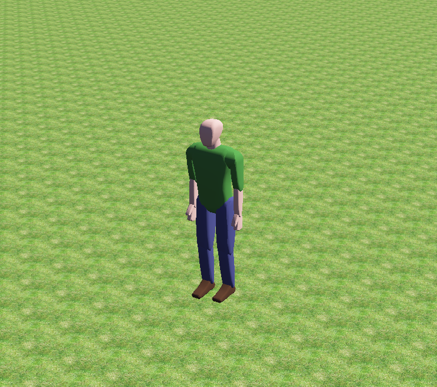

   Pedestrian

Shrimp
~~~~~~~~~~~~~~~~~~~~~~~~~~~~~~~~~~~~~~~~~~

   轮式机器人

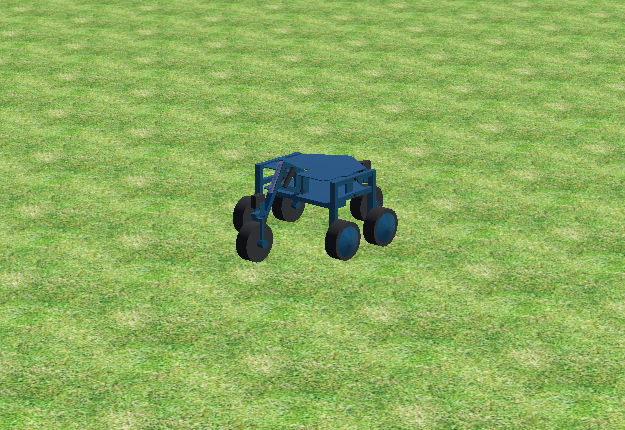

   Shrimp

Create
~~~~~~~~~~~~~~~~~~~~~~~~~~~~~~~~~~~~~~~~~~

   轮式机器人

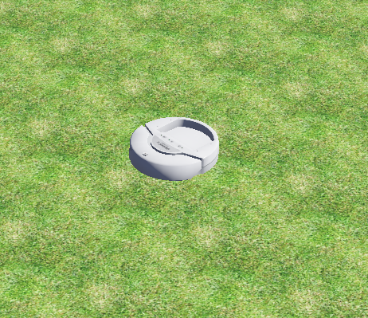

   Create

Sojourner
~~~~~~~~~~~~~~~~~~~~~~~~~~~~~~~~~~~~~~~~~~

   月球车

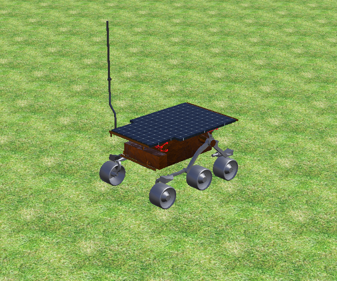

   Sojourner

Mantis
~~~~~~~~~~~~~~~~~~~~~~~~~~~~~~~~~~~~~~~~~~

   大型六足机器人

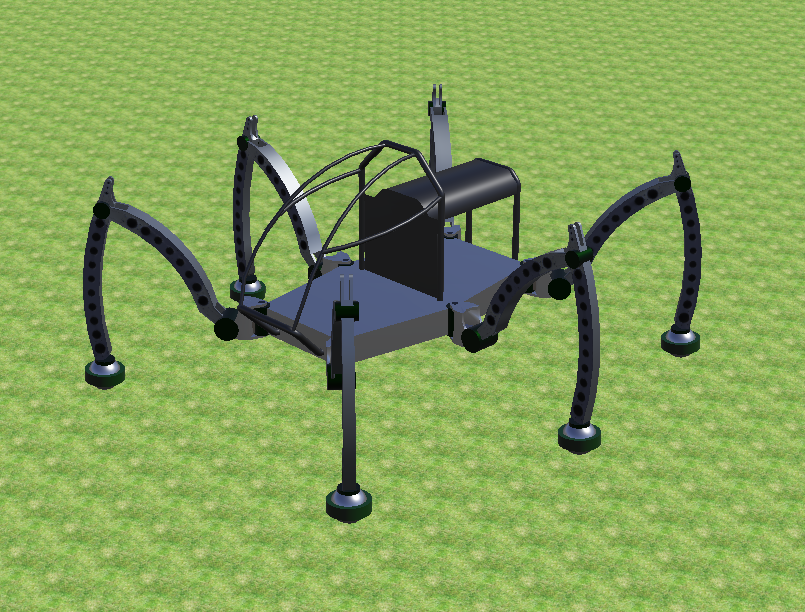

   Mantis

BB-8
~~~~~~~~~~~~~~~~~~~~~~~~~~~~~~~~~~~~~~~~~~

   球形机器人

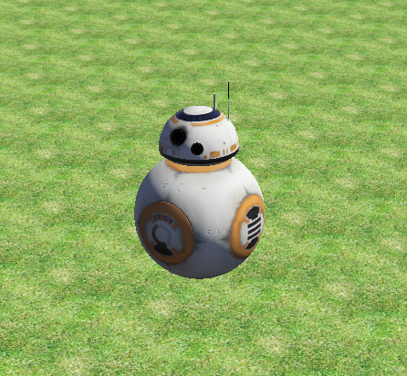

   BB-8

AiboErs7
~~~~~~~~~~~~~~~~~~~~~~~~~~~~~~~~~~~~~~~~~~

   四足机器人

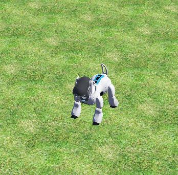

   AiboErs7

BioloidDog
~~~~~~~~~~~~~~~~~~~~~~~~~~~~~~~~~~~~~~~~~~

   四足机器人

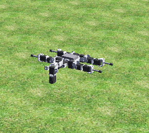

   BioloidDog

FireBird6
~~~~~~~~~~~~~~~~~~~~~~~~~~~~~~~~~~~~~~~~~~

   轮式机器人

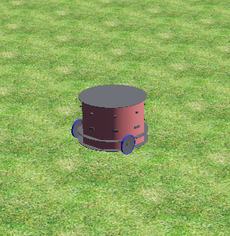

   FireBird6

Scout
~~~~~~~~~~~~~~~~~~~~~~~~~~~~~~~~~~~~~~~~~~

   双足机器人

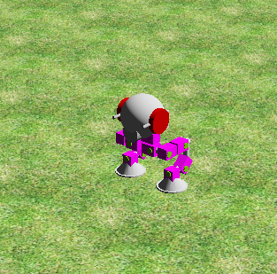

   Scout

GhostDog
~~~~~~~~~~~~~~~~~~~~~~~~~~~~~~~~~~~~~~~~~~

   四足机器人

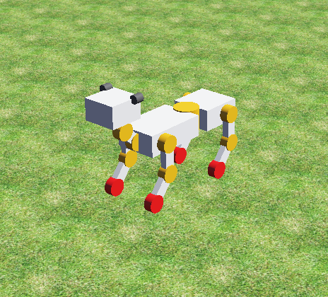

   GhostDog

Hoap2
~~~~~~~~~~~~~~~~~~~~~~~~~~~~~~~~~~~~~~~~~~

   双足机器人

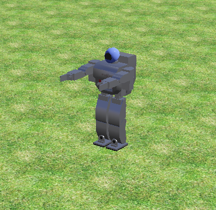

   Hoap2

自定义对象
~~~~~~~~~~~~~~~~~~~~~~~~~~~~~~~~~~~~~~~~~~

   该工程支持自定义被跟踪对象，实现步骤如下：

      1. 按照一定标准建立webots使用的描述文件proto文件，其中必须必须开放到场景树的属性包括"translation"，"rotation"，"name"。描述文件存放在 :code:`UAV_Follow_Env/Webots_Simulation/traffic_project/protos`
      
      .. figure:: ../_static/image/场景树属性包.png
         :alt: 场景树属性包                                  
         :width: 600px                                              
         :align: center

         场景树属性包

      2. 可以选择编写控制器，让被跟踪对象有自主的行为
      3. 在webots的 :code:`IMPORTABLE EXTERNPROTO` 模块中载入已经建立的proto文件

      .. raw:: html

         

            

               
            

            

               
            

         

         

            IMPORT PROTO
         

      4. 把proto的名称写进安全检查文件 :code:`UAV_Follow_Env/Webots_Simulation/traffic_project/config/safetyCheck.py`
      
         .. figure:: ../_static/image/SafeCheck.png
            :alt: SafeCheck                                  
            :width: 600px                                              
            :align: center

            安全检查
      
      5. 在json配置文件中修改 :code:`Tracking_Object` 的描述，其描述应当与proto名称相同
      6. 经过上述步骤就能够使用无人机跟踪自定义对象

.. _内置Reward:

内置Reward
--------------------

   由于Webots中超级智能体的存在，我们可以在每个时刻获取飞机以及被跟踪小车的坐标 :code:`(xf,yf,zf)` 以及 :code:`(xv,yv,zv)` ，并根据实际摄像头的Pitch角度以及设定的摄像头FOV可以直接判断出跟踪是否成功

奖励函数
~~~~~~~~~~~~~~~~~~~~

   对于跟踪器（无人机），奖励函数有2种选择，第一种选择是稀疏奖励，当跟踪对象进入跟踪范围时给予奖励，离开范围时不给予奖励（奖励为0），数学表达式如下：

   .. math::

      r_{d} = \begin{cases}
      1 & t \in I, \\
      0 & \text{otherwise}.
      \end{cases}

   其中 :math:`I` 代表跟踪范围（相机镜头获取的画面范围）， :math:`t` 代表跟踪对象在跟踪范围（相机镜头获取的画面范围）内的位置。

   .. _跟踪对象离散奖励示意图:

   .. figure:: ../_static/image/Discrete_reward.png
      :alt: Discrete_reward
      :width: 600px
      :align: center

      跟踪对象离散奖励示意图

   第二种是密集奖励，通过判断跟踪对象相对跟踪范围中心的位置，给予一个随着距离增大而减小的奖励。奖励越高代表目标离范围中心点越近，反之越远。

   .. _跟踪对象连续奖励示意图:

   .. figure:: ../_static/image/Continuous_reward.png
      :alt: Continuous_reward
      :width: 600px
      :align: center

      跟踪对象连续奖励示意图

   上图是一个跟踪对象处于相机画面中的示意图，记点 :math:`E_{G_{c}}` 到画面中心点 :math:`I_{cG}` 的距离为 :math:`y_{EI}`，跟踪对象点 :math:`P_{GC}` 到中心点 :math:`I_{cG}` 的距离为 :math:`y_{IP}`，记他们的比例为

   .. math::

      x = \frac{y_{IP}}{y_{EI}}

   那么，密集奖励可以使用下面的表达式获得：

   .. math::

      r_{c} = \begin{cases}
      \tanh\left(\alpha(1-x)^{3}\right), & t \in I, \\
      0 & \text{otherwise}.
      \end{cases}

   目标离范围中心点越近时，奖励会越接近1，反之越接近0。 :math:`\alpha` 为常数，建议取值3~5。

基本思路
~~~~~~~~~~~~~~~~~~~~

   .. figure:: ../_static/image/GetReward.png
      :alt: GetReward                                 
      :width: 600px                                              
      :align: center

      内置Reward获取示意图

   1. 首先， 需要从Webots中读出的参数有：飞机的空间坐标 :math:`[x_f,y_f,z_f]` ，被跟踪小车的空间坐标 :math:`[x_v,y_v,z_v]` ，摄像头Camera的Roll角度 :math:`\alpha` 和Pitch角度 :math:`\gamma` 以及Camera的水平视场fieldOfView :math:`FOV_{hor}`

   .. raw:: html

      

          
      

   2. 则可以根据获取图像的分辨率w*h以及Camera的水平视场计算Camera的垂直视场 :math:`FOV_{ver}` ，计算公式为： :math:`FOV_{ver} = 2*\arctan{(\tan(\frac{FOV_{hor}}{2}*\frac{height}{width}))}` ，其中先取tan再取arctan是为了将FOV限制在 :math:`[0,\pi]` 范围内
   
   .. raw:: html

      

          
      

   
   3. 因此，可以计算在当前Camera位姿下，相机FOV对应的实际x方向范围 :math:`[x_{min},x_{max}]` ，以及Camera视场对应的实际距离 :math:`FOV_{height}` ，计算公式如下：

      * :math:`x_{min} = \frac{z_f}{\tan{(\frac{FOV_{ver}}{2}+\gamma)}}`

      .. raw:: html

         

             
         

   
      * :math:`x_{max} = \frac{z_f}{\tan{(|\gamma-\frac{FOV_{ver}}{2}|)}}`
      
      .. raw:: html

         

             
         

      * :math:`FOV_{height} = x_{max}-x_{min}`

      .. raw:: html

         

             
         

      * 因此，可以根据图像中得到的检测点坐标，映射到实际的世界坐标系中

      .. raw:: html

         

             
         

   4. 在上述结果的基础上，可以得到Camera在当前位姿下对应的y方向视场范围 :math:`[y_{min},y_{max}]` ，以及实际距离 :math:`FOV_{width}`

      * :math:`y_{min} = FOV_{height}*\tan{(|\alpha-\frac{FOV_{ver}}{2}|)}`

      .. raw:: html

         

             
         

      * :math:`y_{max} =  FOV_{height}*\tan{(\alpha+\frac{FOV_{ver}}{2})}`

      .. raw:: html

         

             
         

      * :math:`FOV_{width} = y_{max}-y_{min}`

      .. raw:: html

         

             
         

      * 因此可以根据图像中检测点的y坐标映射到实际的坐标系中

      .. raw:: html

         

             
         

   5. 因此，在图像中检测到的像素坐标 :code:`[x,y]` 可以被映射为世界坐标系中的坐标点（高度为0） :code:`[x',y',z']`

      .. raw:: html

         

             
         

      
   6. 对于小车在斜坡上的情况，如下图所示：

      .. figure:: ../_static/image/GetReward2.png
         :alt: GetReward2                               
         :width: 600px                                              
         :align: center

         小车在斜坡情况内置Reward获取示意图

      * 依然可以按照之前的方案进行计算，但是斜坡应该仅和x或和y有关，不应该有弯曲的斜坡，否则很难进行判断
         
         .. raw:: html

            

                
            

         
      * 实际上，由于webots接口足够完善，只需要知道无人机什么时候在观察斜坡即可，斜坡可以有一定的复杂性（但每一段必须是平面，不能是曲面）。

数据获取
~~~~~~~~~~~~~~~~~~~~

**getFromDef()**

   首先在Webots中通过 :code:`getFromDef()` 函数获取指向地面和摄像头节点的指针

**getPose()**

   Node节点有 :code:`getPose(Node *fromNode)` 函数，可以获取该节点的姿态齐次变换矩阵（4X4）。给 :code:`fromNode` 指向参考坐标系，如果传入该参数，比如:

   .. code:: c++

      land_node->getPose(camera_slot_node);

   则返回的是地面相对相机坐标系的齐次变换矩阵。

实现原理
~~~~~~~~~~~~~~~~~~~~

**相机焦距估算**

   根据小孔成像的原理，可以估算Webots中相机的焦距，由于一般有 :math:`z_{o}\gg z_{i}` ，所以可以认为 :math:`f\approx z_{i}`

   .. figure:: ../_static/image/小孔成像.png
      :alt: 小孔成像原理图                                  
      :width: 600px                                              
      :align: center

      小孔成像原理图

   .. raw:: html

      To Do: 上图要重新自己用PPT画

   因此，焦距f的估算如下所示，交点处为透镜光心：

   .. figure:: ../_static/image/焦距估算.png
      :alt: 焦距估算原理图                                  
      :width: 600px                                              
      :align: center

      焦距估算原理图

   .. raw:: html

      To Do: 上图要重新自己用PPT画

   可得: :math:`\frac{f}{\frac{1}{2} \times  width } =tan(\frac{1}{2} \times FOV)`           **焦距的单位：像素**

   投影相机图像像素点到3维空间

   .. figure:: ../_static/image/三维小孔成像.png
      :alt: 三维小孔成像原理图                                  
      :width: 600px                                              
      :align: center

      三维小孔成像原理图

   .. raw:: html

      To Do: 上图要重新自己用PPT画

   由于图像大小和焦距比例已知，因此连接像素点和光心的空间向量已知。
   用两点式构建直线方程，用齐次变换矩阵构造目标平面B的平面方程，求解交点，即可得到3维空间坐标。

   .. figure:: ../_static/image/求解三维空间坐标.png
      :alt: 求解三维空间坐标原理图                                  
      :width: 600px                                              
      :align: center

      求解三维空间坐标原理图

   .. raw:: html

      To Do: 上图要重新自己用PPT画，并且推导全部转化成公式形式

投影可视化
~~~~~~~~~~~~~~~~~~~~

   通过Webots的supervisor节点，调用 :code:`importMFNodeFromString()` 函数给世界添加节点。
   对相机的4个角点和中心点进行投影并可视化:

   .. code:: c++

      std::string ballprotoString = "DEF LocationBall" + std::to_string(i + 1) + " trajectary {translation " + std::to_string(0+i) + " " + std::to_string(0+i) + " " + std::to_string(0) + "}";
      
      robot->getRoot()->getField("children")->importMFNodeFromString(-1, ballprotoString); // 导入坐标球

   通过获取 :code:`translation` 域，然后传入投影的空间3维坐标，可以实时改变投影点的位置

   .. code:: c++

      robot->getFromDef("LocationBall1")->getField("translation")->setSFVec3f(location00.data());

   效果如下视频：

   .. raw:: html

      <video width="640" height="360" controls>
         <source src="../_static/video/GetReward_Video.mp4" type="video/mp4">
         Your browser does not support the video tag.
      </video>

   .. raw:: html

      

         注意：视场角上限不能超过地平线，否则计算结果没有意义。
      

如何转化为Reward
~~~~~~~~~~~~~~~~~~~~

1. (对于跟踪算法而言：如Follow_Anything)用于计算reward共有三个变量：
   
   a. 跟踪算法输出被跟踪目标的像素点中点，并且投影到地面坐标系的二维位置，记为P1
   b. 仿真环境中被跟踪目标在地面坐标系中的实际位置，由Supervisor获得，记为P2
   c. 仿真环境中无人机摄像头视平面的期望跟踪点，投影到地面坐标系的二维位置，记为P3

2. (对于强化学习算法为而言：如D-VAT)用于计算reward共有两个变量：

   a. 仿真环境中被跟踪目标在地面坐标系中的实际位置，由Supervisor获得，记为P1
   b. 仿真环境中无人机摄像头视平面的期望跟踪点，投影到地面坐标系的二维位置，记为P2

3. 首要目标是实现无人机tracking，是否正确tracking是获得奖励的前提。因此要求P1与P2之间的距离在给定范围以内，即可获得奖励值1，在给定范围以外，直接消除所有奖励，输出奖励0。使用阶跃函数实现：

   .. figure:: ../_static/image/阶跃函数.png
      :alt: 阶跃函数                                  
      :width: 600px                                              
      :align: center

      阶跃函数示意图

   .. raw:: html

      To Do: 上图要重新自己用PPT画

4. 次要目标是无人机tracking得更好。因此P1与P3之间的距离可以作为奖励的惩罚项。距离越远惩罚越大。使用正切双曲线函数实现： :math:`f(x)=\frac{e^{αx}-e^{-αx}}{e^{αx}+e^{-αx}}`

   .. figure:: ../_static/image/双曲正切函数.png
      :alt: 双曲正切函数                                  
      :width: 600px                                              
      :align: center

      双曲正切函数示意图

   .. raw:: html

      To Do: 上图要重新自己用PPT画

5. 最终的奖励计算框图如下：

   .. figure:: ../_static/image/奖励框图.png
      :alt: 奖励框图                                  
      :width: 600px                                              
      :align: center

      奖励框图

.. _定制化参数接口:

定制化参数接口
--------------------

输入动作
~~~~~~~~~~~~~~~~~~~~

   输入动作用于控制无人机的运动，目前无人机有四个动作，前进，后退，左移，右移，加上reset数据共5个浮点数

返回参数
~~~~~~~~~~~~~~~~~~~~

   返回参数主要包括三个部分，基础数据包，自定义奖励数据包，雷达数据包

**基础数据包**

   基础数据包共22个浮点数，如下所示：

   .. code:: c++
      
      typedef struct _Odometry{
        double t;// 仿真步数（不是仿真时间）
        vector3 position;//三轴位置m
        vector3 linear;//三轴线速度m/s
        vector3 acc;//三轴加速度m/s^2
        vector3 angular;//三轴角速度rad
        vector4 orientation;//四元数
        vector3 angle;//欧拉角
        double reward;//reward
        double done;//是否结束仿真
      }Odometry;

.. raw:: html

   <html>

   <head>

       

   </head>

   <body>

   <table>
    <tr class="merged-cell">
        <th>Category</th>
        <th>Sensor</th>
        <th>Parameter</th>
        <th>Type</th>
        <th>Description</th>
        <th>Potential Tasks</th>
    </tr>
    <tr class="merged-cell">
        <td rowspan="2" class="vision-row merged-cell">Vision</td>
        <td>Camera</td>
        <td>Image</td>
        <td>Mat</td>
        <td>Images captured by the camera</td>
        <td>Default sensor</td>
    </tr>
    <tr class="row-line merged-cell">
        <td>Lidar</td>
        <td>LidarCloud</td>
        <td>vector2000</td>
        <td>Point cloud from RpLidarA2(m)</td>
        <td>Obstacle avoidance</td>
    </tr>
    <tr class="merged-cell">
        <td rowspan="6" class="motion-row merged-cell">Motion</td>
        <td rowspan="2" class="merged-cell">GPS</td>
        <td>Position</td>
        <td>vector3</td>
        <td>Position (m)</td>
        <td>Visual navigation</td>
    </tr>
    <tr class="merged-cell">
        <td>Linear</td>
        <td>vector3</td>
        <td>Linear velocity (m/s)</td>
        <td>Visual navigation</td>
    </tr>
    <tr class="merged-cell">
        <td>Accelerometer</td>
        <td>Acc</td>
        <td>vector3</td>
        <td>Acceleration (m/s^2)</td>
        <td>Visual navigation</td>
    </tr>
    <tr class="merged-cell">
        <td>Gyroscope</td>
        <td>Angular</td>
        <td>vector3</td>
        <td>Angular velocity (rad/s)</td>
        <td>Robot posture stabilization</td>
    </tr>
    <tr class="merged-cell">
        <td rowspan="2" class="merged-cell">IMU</td>
        <td>Angle</td>
        <td>vector3</td>
        <td>Eular angles (rad)</td>
        <td>Robot posture stabilization</td>
    </tr>
    <tr class="row-line merged-cell">
        <td>Orientation</td>
        <td>vector4</td>
        <td>Quaternion representation</td>
        <td>Robot posture stabilization</td>
    </tr>
   </table>
   </body>
   </html>
    

**自定义奖励数据包**

   自定义奖励数据包共51个浮点数+1个字符串，包括以下部分

   .. code:: c++
      
      typedef struct _rewardData{
        double cameraWidth;// 图像宽度（像素）
        double cameraHeight;// 图像高度（像素）
        double cameraFov;// 摄像头视场角（rad）[0,pi`    ]
        double cameraF;// 摄像头焦距估算（像素）
        double T_ct[16];// 摄像头相对于世界坐标系的齐次变换矩阵
        double T_tw[16];// 车辆相对于世界坐标系的齐次变换矩阵
        vector3 cameraMidGlobalPos;// 摄像头中心映射到地面在世界坐标系下的三维坐标
        vector3 carMidGlobalPos;// 车辆中心在世界坐标系下的三维坐标
        vector3 cameraMidPos; // 摄像头中心世界坐标系的坐标
        vector4 carCameraPosOri; // 车辆中心在无人机坐标系下的1D姿态+3D坐标（第一个元素是姿态）
        double crash; // 无人机是否与建筑物碰撞
        double carDir;// 车辆运行方向(0停止，1直行，2左转，3右转)
        std::string carTypename;// 对象类型
      }rewardData;

   - 其中，参数 :code:`carCameraPosOri` 中无人机坐标系定义和姿态角定义如下：
   
   .. figure:: ../_static/image/无人机坐标系.png
      :alt: 无人机坐标系                                  
      :width: 600px                                              
      :align: center

      无人机坐标系定义

   .. raw:: html

      To Do: 上图要重新自己用PPT画

**雷达数据包**

   雷达点云数据。该环境中的无人机搭载了RpLidarA2单线雷达，其点云数据将输出一个很长的数组。

   .. raw:: html

      To Do: 把Webots现有的可以增加的雷达也加入进去吧