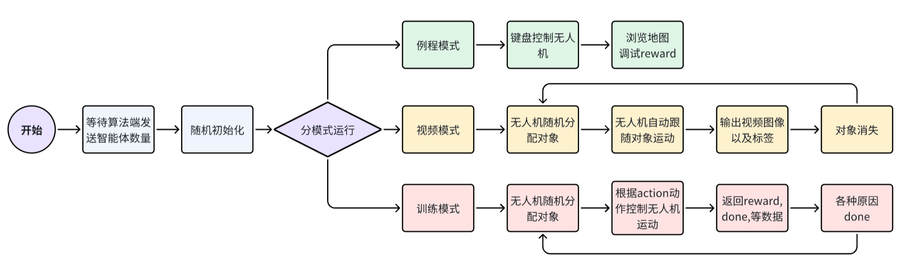
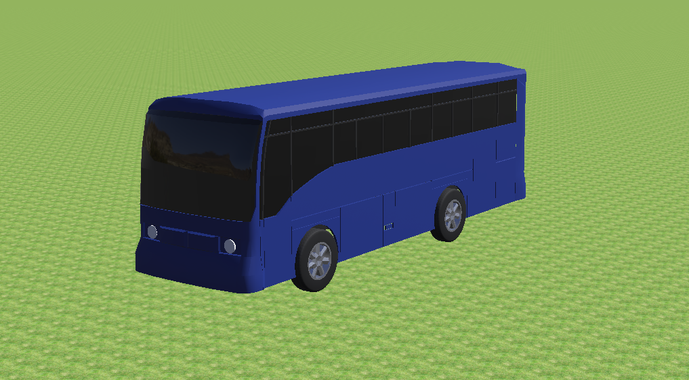
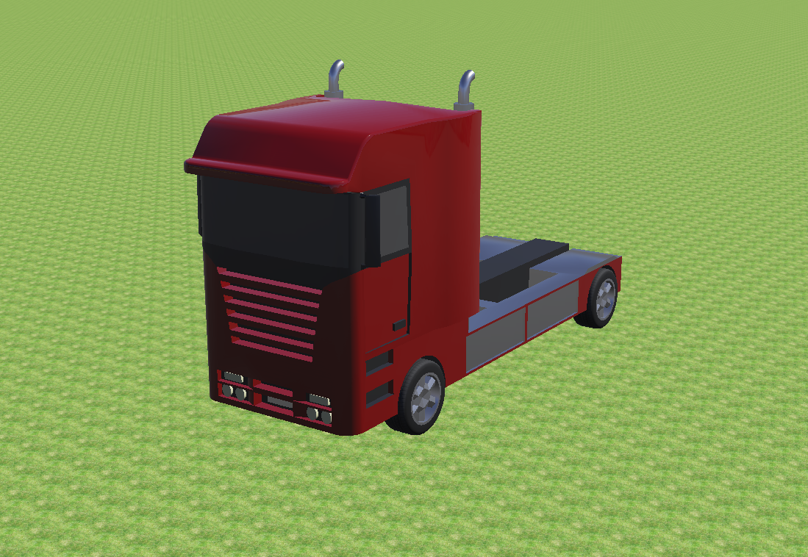
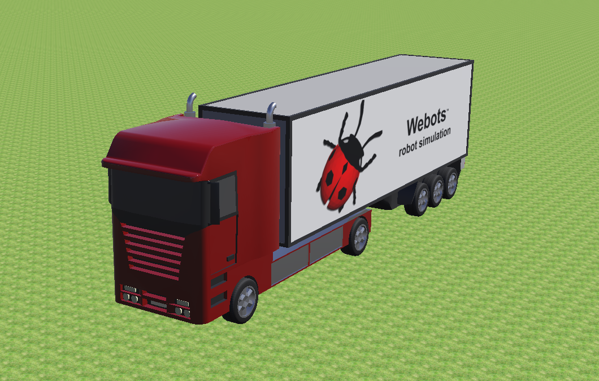

Simulation Environment
=======================

    .. raw:: html

        

        <!-- Language switch buttons -->
        

            <b style="font-size: 18px;">You can choose language by </b>
            <button onclick="switchLanguage('zh')">中文</button>
            <button onclick="switchLanguage('en')">English</button>
        

        
         
        

         
         

.. _Environment Introduction:

Environment Introduction
----------

- The simulation environment of this project is built based on the open-source simulation software Webots. The background of the simulation environment simulates the target tracking problem in outdoor scenes in real life. For this purpose, six maps have been set up, including city streets, city center, lakeside, countryside, desert, and farmland, each of which evolves into various conditions such as day, night, foggy, and snowy, making a total of 24 environments. To facilitate model training from simple environments, several simple environment maps are also available for use.
- Schematic diagrams of 24 simulation environments in the project:

.. image:: ../_static/image/24Scene_Colorful2.png
   :alt: 24个环境示意图
   :width: 700px
   :align: center

.. raw:: html

    

.. _Operation Flow:

Operation Flow
----------

.. raw:: html

   

      To accommodate different needs such as training, debugging, etc., this project offers <b>3 different running modes</b>.
   

    

demo mode
~~~~~~~~~

   This mode generates a tracker in the map. The tracker can fly through the map by keyboard operation, allowing you to browse the map. Meanwhile, the tracker by default tracks a BmwX5 vehicle near its initial position and outputs the reward parameters in real time on the Console status bar. This object can be used to test whether the built-in reward parameters are reasonable for debugging purposes.

video mode
~~~~~~~~~~

   - This mode is mainly used to record the behavior of the tracked object. The environment will automatically schedule the tracker error tracking object and export video images according to the simulation time and configuration parameters, while generating labels corresponding to each image.
   - The data is stored in: :code:`./Webots_Simulation/traffic_project/droneVideos/DRONEX/episodeX`, with the image format as jpeg and the labels in the :code:`mark.json` file.
   - At the same time, you can generate multiple sets of video image file structure descriptions through the script by directly executing the :code:`./Webots_Simulation/traffic_project/fileStruct.py` script, which will generate the description file :code:`dir_info.json` in the same directory.

training mode
~~~~~~~~~~

   This mode is used for algorithm training. You can choose to manually open the Webots simulation first and then run the training script, or you can choose to modify the algorithm configuration file to achieve one-click full startup of the algorithm.

Parameter Configuration
-----------

   .. raw:: html

      

         All settings for the simulation environment in this project can be efficiently configured using <b>1 JSON file</b>.
      

       

   .. raw:: html

    

        The configuration file for the simulation environment is: <code>Webots_Simulation/traffic_project/config/env_config.json</code>.
    

Basic Parameters
~~~~~~~~~~~

.. code:: json

   {
      "Simulation_Mode": "demo",
      "Tracker_Def": "DRONE",
      "Drone_Supervisor_Ctrl": true,
      "Socket_Ip": "127.0.0.1",
      "Config_Agen_Num_Port": 38711,
      "Train_Total_Steps": 1500,
      "Init_No_Done_Steps": 100,
      "No_Reward_Done_Steps": 100,
      "Control_Frequence": 125,
      "Customized_Rewards": true,
      "Lidar_Enable": false,
      "Tracking_Object": "SUMO_VEHICLE",
      "Verbose": false
   }

**Parameter Description**

   * :code:`Simulation_Mode` : There are three simulation modes: "demo", "video", and "train". The demo and video modes are self-running modes of the simulation (default is demo).

      * The demo will generate a tracker in the map, which supports direct control via the keyboard. Meanwhile, it will track a stationary vehicle, Bmx, by default. This mode can be used to browse the map or debug the reward parameters.
      * The video mode is the video shooting mode. In this mode, the tracker will automatically track the target object, exporting video images and labels.
      * train is the training mode, where the simulation end interacts with the algorithm end to train the tracking algorithm of the tracker.
      * For the complete system operation flowchart, see: :ref:`Operation Flow`

   - :code:`Tracker_Def` : Select the tracker, the current options are drone ("DRONE") and car ("CAR"). Among them, the drone is a simulated drone tracker with physical property detection and constraints, while the car is considered an ideal tracker that ignores its own physical properties and can perform any action under any circumstances.
   - :code:`Drone_Supervisor_Ctrl` : Whether to use the supervisor to control the tracker. The supervisor is Webots' super administrator and can directly control any node. If true, the supervisor controls the tracker, and all its actions are real-time and responsive, which simplifies algorithm training. If false, the tracker is controlled using a traditional PID controller. This parameter is only applicable to the drone tracker; the car tracker always uses the supervisor for control.
   - :code:`Socket_Ip` : The IP address for socket communication, defaults to **"127.0.0.1"** if communicating locally.
   - :code:`Config_Agen_Num_Port` : Configures the socket communication port, which is used to communicate with the algorithm end to determine the number of trackers (agents) to be set.
   - :code:`Train_Total_Steps` : The maximum number of training steps. If the steps exceed this number, the simulation returns done.
   - :code:`Init_No_Done_Steps` : The number of simulation steps without done status during initialization. This prevents the unstable physical properties of the tracker during initialization from triggering the done status. This parameter should be set to a reasonable value.
   - :code:`No_Reward_Done_Steps` : The number of simulation steps that result in a done status when the reward is continuously zero, which helps improve training efficiency.
   - :code:`Control_Frequence` : The control frequency for the control algorithm. During training, the simulation end executes at a fixed control frequency of 500Hz based on the simulation time. This parameter is used to adjust the average control frequency of the algorithm end.

   * :code:`Customized_Rewards`: Whether to enable the customized reward parameter. Users can calculate rewards based on the customized reward parameter.

      * For more details on the customized reward parameter, see: :ref:`定制化参数接口`
   * :code:`Lidar_Enable`: Whether to enable lidar point cloud data.

      * For more details on lidar point cloud data, see: :ref:`定制化参数接口`
   * :code:`Tracking_Object`: The tracked object setting (default is SUMO_VEHICLE). Example tracking objects include "SUMO_VEHICLE", "Pedestrian", "Shrimp", "Create", "Sojourner", "Mantis", etc. Custom tracking objects are also supported. See the project manual.

      * For detailed descriptions of tracking object types, see: :ref:`追踪对象`

   * :code:`Verbose`: Enable log recording. If set to true, some important parameters will be printed in the Webots terminal window for users to observe. Additionally, program run logs will be generated in the :code:`Webots_Simulation/traffic_project/logs` folder, mainly for debugging the simulation environment.

      .. image:: ../_static/image/webots日志输出.png
         :alt: webots日志输出（“train”&“video”）
         :width: 500px
         :align: center

      * :code:`id` : The name of the tracker.
      * :code:`done` : Whether to return done.
      * :code:`reward` : The current reward size.
      * :code:`count` : The step count of steps.
      * :code:`time` : Simulation time.
      * :code:`carDir` : The movement direction of the tracked target.
      * :code:`pitchAngle` : The pitch axis angle of the camera.
      * :code:`doneState` : The reason for generating done, including "height" (unreasonable tracker height), "distance" (the error between the tracker's target position and the actual position is too large), "velocity" (unreasonable tracker movement speed), "yaw velocity" (unreasonable tracker rotational speed around the vertical axis), "pitch or yaw angle" (unreasonable tracker attitude).

Tracker (only effective for drones) generates a physical range parameter configuration of done
~~~~~~~~~~~~~~~~~~~~~~~~~~~~~~~~~~~~~~~~~~~~~~~~

.. code:: json

   "Done_Range": {
        "max_height": 50,
        "min_height": 2,
        "velocity": 100,
        "omiga": 6.283,
        "roll": 1.22,
        "pitch": 1.22,
        "distance_error": 50
   }

**Parameter Description**

   - :code:`max_height` ：Tracker maximum flight altitude (m).
   - :code:`min_height` ：Tracker minimum flight altitude (m).
   - :code:`velocity` ：Tracker maximum flight velocity (m/s).
   - :code:`omiga` ：Tracker maximum angular velocity (rad/s).
   - :code:`roll` ：Tracker maximum roll angle (rad).
   - :code:`pitch` ：Tracker maximum pitch angle (rad).
   - :code:`distance_error` ：Maximum error between the tracker's desired position and current position (m).

Built-in reward parameter configuration (valid for drones only, cars return reward=1 by default)
~~~~~~~~~~~~~~~~~~~~~~~~~~~~~~~~~~~~~~~~~~~~~~~~~~~~~~~~

.. code:: json

   "Reward_Config": {
        "reward_type": "view",
        "reward_mode": "continuous",
        "reward_cut_off": 0.001,
        "distance_scale": 0.01,
        "distance_range": 7,
        "view_scale": 4,
        "view_range": 0.7
   }

**Parameter Description**

   - :code:`reward_type` : The type of reward (default is view). "View" detects based on the quadrilateral projected onto the ground from the camera's perspective, while "distance" detects based on the distance from the midpoint projection in the camera's view to the target.
   - :code:`reward_mode` : The default mode of reward. "Continuous" produces a continuous floating-point number between [0, 1], while "discrete" produces an integer of 0 or 1.
   - :code:`reward_cut_off` : Reward cut-off. When the obtained reward is less than this value, :code:`No_Reward_Done_Steps` starts counting.
   - :code:`distance_scale` : Distance scale (default is continuous). This parameter is only effective in continuous mode and controls the decay rate of the reward due to distance error.
   - :code:`distance_range` : The distance error range for generating rewards.

   * :code:`view_scale` : View scale. This parameter is only effective in continuous mode and view type, controlling the decay rate of the reward due to deviation from the view center.
      
      * For specific parameter meanings, see: :ref:`内置Reward`
   
   - :code:`view_range` : The view range for generating rewards. This parameter is used to scale the quadrilateral used for reward calculation, i.e., the size of the quadrilateral box in the camera view. Generally, the range is set to [0,1].

SUMO Traffic System Parameter Configuration
~~~~~~~~~~~~~~~~~~~~~~~~~~~~~~~~~~~~~~~~~~

.. code:: json

   "Sumo_Params": {
        "rou_update": false,
        "max_sumo_car": 40,
        "fixed_car_group_num": true,
        "car_group_num": 5,
        "car_import_interval": 52.0,
        "car_type": "passenger",
        "fixed_color": false,
        "normalize_color": [1,0,0],
        "max_car_speed": 20,
        "max_car_accel": 25,
        "max_car_decel": 25,
        "max_rou_distance": 7000,
        "min_rou_distance": 500,
        "route_num": 100000,
        "fixed_seed": false,
        "random_seed": 1
   }

**Parameter Description**

   - :code:`rou_update` : Whether the traffic simulation route file is updated. If you want to obtain a specific route, set it to false. **Note:** Any change in the parameters of this module will cause the route to refresh automatically.
   - :code:`max_sumo_car` : Maximum number of vehicles in the map.
   - :code:`fixed_car_group_num` : Whether to customize the number of vehicles added to the environment in each group.
   - :code:`car_group_num` : Custom number of vehicles added to the environment in each group. **Note:** In training and video mode, if this parameter is set unreasonably (< Agent number * 3), the system will automatically set a reasonable parameter (= Agent number * 3), otherwise the environment cannot run stably.
   - :code:`car_import_interval` : The interval time (s) between each group of vehicles added to the map.

   * :code:`car_type` : The type of vehicle (default is passenger), including "passenger", "bus", "truck", "trailer", "motorcycle".

      * All supported vehicle types can be found at: :ref:`SUMO_VEHICLE`

   - :code:`fixed_color` : Whether to fix the vehicle color.
   - :code:`normalize_color` : Normalized RGB color vector.
   - :code:`max_car_speed` : Maximum vehicle speed (m/s).
   - :code:`max_car_accel` : Maximum vehicle acceleration (m/s^2).
   - :code:`max_car_decel` : Maximum vehicle deceleration (m/s^2).
   - :code:`max_rou_distance` : Maximum route length (m).
   - :code:`min_rou_distance` : Minimum route length (m).
   - :code:`route_num` : Maximum number of routes (note that this is the maximum, :code:`obj_edge_distribution_multilateral` may actually have fewer routes than the set parameter due to the randomization process).
   - :code:`fixed_seed` : Whether to use a fixed random seed. If you want to obtain stable routes and vehicle styles, set it to true.
   - :code:`random_seed` : The fixed random seed.

Other object tracking parameter configuration
~~~~~~~~~~~~~~~~~~~~~~~~~~~~~~~~~~~~~~~~~~
Only effective when :code:`Tracking_Object` is not "SUMO_VEHICLE".

.. code:: json

   "Other_Params": {
        "max_obj_num": 10,
        "obj_import_interval": 0.5,
        "import_group_num": 4,
        "obj_edge_distribution_random": false,
        "obj_edge_distribution_multilateral": false,
        "obj_edge_distribution_fixed": 0,
        "obj_edge_distribution_max":10,
        "obj_edge_distribution_min":-10
   }

**Parameter Description**

   - :code:`max_obj_num` ：Maximum number of objects.
   - :code:`obj_import_interval` ：Time interval (s) for adding each group of objects to the map.
   - :code:`import_group_num` ：Number of objects added per group.
   - :code:`obj_edge_distribution_random` ：Whether to enable random distribution of objects along the sides of the map roads. If true, objects will be randomly placed in a random direction at random positions on a random path. If false, objects will be placed at a fixed distance in the vertical direction at random positions on a random path.
   - :code:`obj_edge_distribution_multilateral` ：Whether to enable bilateral distribution. If true, the distribution range will be :code:`[min, max] ∪ [-max, -min]` . If false, the distribution range will be :code:`[min, max]` .
   - :code:`obj_edge_distribution_fixed` ：Fixed distance (m) from the center of the road.
   - :code:`obj_edge_distribution_max` ：Maximum distance (m) from the center of the road.
   - :code:`obj_edge_distribution_min` ：Minimum distance (m) from the center of the road.

Output video parameter configuration
~~~~~~~~~~~~~~~~~~~~~~~~~~~~~~~~~~~~~~~~~~
Effective only when :code:`Simulation_Mode` is not “video”.

.. code:: json

   "Out_Video": {
        "channels": 4,
        "fps": 50.0,
        "start_time": 1.0,
        "total_time": 50.0,
        "warm_up_steps": 30,
        "output_car_dir": false,
        "random_action": true,
        "forward_speed":40,
        "backward_speed":-40,
        "left_speed":40,
        "right_speed":-40,
        "cw_omega":2,
        "ccw_omega":-2
   }

**Parameter Description**

   - :code:`channels` ：Number of video channels, which corresponds to the number of trackers in the imported map.
   - :code:`fps` ：Frames per second calculated based on simulation time (video frames are exported at this frame rate).
   - :code:`start_time` ：Simulation time (s) at which video export begins.
   - :code:`total_time` ：Duration of the video in simulation time (s).
   - :code:`warm_up_steps` ：The number of steps after reset during which no data is output. Note that each step has a cycle of 2ms.
   - :code:`output_car_dir` ：Whether to output the vehicle direction. If enabled, only the vehicle movement direction is output; otherwise, reward and action are output (Vehicle directions: 0 stop, 1 forward, 2 left turn, 3 right turn).
   - :code:`random_action` ：Whether the tracker uses random actions. If enabled, random actions are output based on Control_Frequency. Otherwise, the tracker will precisely follow the vehicle, and the action output will be -1 (meaningless).
   - :code:`forward_speed` ：Forward speed of the tracker’s random action (m/s).
   - :code:`backward_speed` ：Backward speed of the tracker’s random action (m/s).
   - :code:`left_speed` ：Leftward speed of the tracker’s random action (m/s).
   - :code:`right_speed` ：Rightward speed of the tracker’s random action (m/s).
   - :code:`cw_omega` ：Clockwise rotation speed of the tracker’s random action (rad/s).
   - :code:`ccw_omega` ：Counterclockwise rotation speed of the tracker’s random action (rad/s).

Tracker Control Parameter Configuration
~~~~~~~~~~~~~~~~~~~~~~~~~~~~~~~~~~~~~~~~~~

   This set of parameters is used to randomize the tracking properties of the tracker itself.

.. code:: json

   "Drone_Random_Config": {
        "start_time_bias_ms": 310,

        "view_pitch_random": false,
        "view_pitch_fixed": 1,
        "view_pitch_random_max": 1.57,
        "view_pitch_random_min": 0.7,

        "height_random": true,
        "height_fixed": 15.0,
        "height_random_max": 25.0,
        "height_random_min": 13.0,

        "direction_random": false,
        "direction_random_multilateral": false,
        "direction_fixed": 0,
        "direction_random_max": 0.1,
        "direction_random_min": -0.1,

        "horizon_bias_random": false,
        "horizon_bias_multilateral": true,
        "horizon_bias_fixed": 0,
        "horizon_bias_random_max": 3,
        "horizon_bias_random_min": 0.1,
        
        "verticle_bias_random": false,
        "verticle_bias_multilateral": true,
        "verticle_bias_fixed": 0,
        "verticle_bias_random_max": 3,
        "verticle_bias_random_min": 0.1
   }

**Parameter Description**

   * :code:`start_time_bias_ms` : Due to the time required for environment initialization, theoretically, the more agents are set, the longer the initialization time. This parameter can adjust the overall initialization time.

      * **Note: The total initialization time will increase with the number of agents set, and it will be longer than the time set by this parameter.**

   - :code:`view_pitch_random` : Randomization of the tracker camera pitch angle.

   * :code:`view_pitch_fixed` : If the above parameter is false, the angle defined by this parameter will be used.

      * If the angle is greater than 0, it is a downward pitch; otherwise, it is an upward pitch.
      * In practical usage, a downward pitch is common. Therefore, the parameter range in the simulation environment is limited to :code:`[0.5, 1.57](rad)`.

   - :code:`view_pitch_random_max` : Maximum camera downward pitch.
   - :code:`view_pitch_random_min` : Minimum camera downward pitch.
   - :code:`height_random` : Randomization of tracker flight height. Other parameter meanings are the same as above.
   - :code:`direction_random` : Randomization of the tracker’s initial view direction following the object, with a range of :code:`[-pi,pi](rad)`.

   * :code:`direction_random_multilateral` : Whether to enable bilateral randomization configuration.
      
      * false, :code:`[min, max]` ; true, :code:`[-max, -min] ∪ [min, max]`

   - :code:`horizon_bias_random` : Horizontal offset of the initial view tracker tracking object. If the subsequent parameter is positive, the object shifts to the left; if negative, the object shifts to the right. Other parameters are the same as above.
   - :code:`verticle_bias_random` : Vertical offset of the initial view tracker tracking object. If the subsequent parameter is positive, the object shifts upward; if negative, the object shifts downward. Other parameters are the same as above.

Configuration Parameter Recommendations
~~~~~~~~~~~~~~~~~~~~~~~~~~~~~~~~~~~~~~~~~~

   For recommendations on simulator parameter configurations, please refer to the document: :doc:`Configuration`.
   
.. raw:: html

   To Do

.. _Tracked Objects:

Tracked Objects
--------------------

   .. raw:: html

      

            This project provides 18 types of 24 predefined tracking targets, and offers a plug-and-play interface that supports users in utilizing self-designed models and controllers.
      

.. _SUMO_VEHICLE:

SUMO_VEHICLE
~~~~~~~~~~~~~~~~~~~~~~~~~~~~~~~~~~~~~~~~~~

   SUMO_VEHICLE is controlled by the SUMO traffic management system to manage the traffic conditions on the map, allowing vehicles to follow planned routes on the map. The type of vehicle can be specified.

**passenger**

   Passenger cars include common sedans, SUVs, and business vehicles, as shown below:

   .. raw:: html

      

         <figure style="text-align: center; width: 25%;">
            
            <figcaption>BmwX5</figcaption>
         </figure>
         <figure style="text-align: center; width: 25%;">  
            
            <figcaption>CitroenCZero</figcaption>
         </figure>
         <figure style="text-align: center; width: 25%;">
            
            <figcaption>LinkolnMKZ</figcaption>
         </figure>
         <figure style="text-align: center; width: 25%;">
            
            <figcaption>MercedesBenzSprinter</figcaption>
         </figure>
      

   .. raw:: html

      

         <figure style="text-align: center; width: 33%;">
            
            <figcaption>RangeRoverSportSVR</figcaption>
         </figure>
         <figure style="text-align: center; width: 33%;">
            
            <figcaption>TeslaModel3</figcaption>
         </figure>
         <figure style="text-align: center; width: 33%;">
            
            <figcaption>ToyotaPrius</figcaption>
         </figure>
      

.. .. figure:: ../_static/image/BMWX5.png
..    :alt: BMWX5                                            
..    :width: 500px                                              
..    :align: center   

..    BmwX5

.. .. figure:: ../_static/image/CITROENCZero.png
..    :alt: CITROENCZero
..    :width: 500px
..    :align: center

..    CitroenCZero

.. .. figure:: ../_static/image/LINKOLNMKZ.png
..    :alt: LINKOLNMKZ
..    :width: 500px
..    :align: center

..    LinkolnMKZ

.. .. figure:: ../_static/image/MERCEDESBENZSprinter.png
..    :alt: MERCEDESBENZSprinter
..    :width: 500px
..    :align: center

..    MercedesBenzSprinter

.. .. figure:: ../_static/image/RANGEROVERSportSVR.png
..    :alt: RANGEROVERSportSVR
..    :width: 500px
..    :align: center

..    RangeRoverSportSVR

.. .. figure:: ../_static/image/TESLAModel3.png
..    :alt: TESLAModel3
..    :width: 500px
..    :align: center

..    TeslaModel3

.. .. figure:: ../_static/image/TOYOTAPrius.png
..    :alt: TOYOTAPrius
..    :width: 500px
..    :align: center

..    ToyotaPrius

**bus**

   Unified model, large passenger vehicles

   Bus

**truck**

   Unified vehicle type, truck without cargo box

   Truck

**trailer**

   Unified model, truck with cargo box

   Trailer

motorcycle
~~~~~~~~~~~~~~~~~~~~~~~~~~~~~~~~~~~~~~~~~~

   Two types of vehicles, motorcycles

   .. raw:: html

      

         <figure style="text-align: center; width: 50%;">
            
            <figcaption>Scooter</figcaption>
         </figure>
         <figure style="text-align: center; width: 50%;">
            
            <figcaption>Motorbike</figcaption>
         </figure>
      

   

Pedestrian
~~~~~~~~~~~~~~~~~~~~~~~~~~~~~~~~~~~~~~~~~~

   Pedestrian objects will move along a certain path at a certain speed, and the human body will simulate real human gait during motion.

   .. raw:: html

      

         <figure style="text-align: center; width: 33%;">
            
         </figure>
         <figure style="text-align: center; width: 33%;">
            
         </figure>
         <figure style="text-align: center; width: 33%;">
            
         </figure>
      

      
Pedestrian

Wheel Robots
~~~~~~~~~~~~~~~~~~~~~~~~~~~~~~~~~~~~~~~~~~

   Wheel Robots

   .. raw:: html

      

         <figure style="text-align: center; width: 33%;">
            
            <figcaption>Shrimp</figcaption>
         </figure>
         <figure style="text-align: center; width: 33%;">
            
            <figcaption>Create</figcaption>
         </figure>
         <figure style="text-align: center; width: 33%;">
            
            <figcaption>Sojourner Rover</figcaption>
         </figure>
      

   
   .. raw:: html
   
      

         <figure style="text-align: center; width: 50%;">
            
            <figcaption>BB-8 Spherical Robot</figcaption>
         </figure>
         <figure style="text-align: center; width: 50%;">
            
            <figcaption>FireBird6</figcaption>
         </figure>
      

   

Legged Robots
~~~~~~~~~~~~~~~~~~~~~~~~~~~~~~~~~~~~~~~~~~

   .. raw:: html

      

         <figure style="text-align: center; width: 33%;">
            
            <figcaption>Mantis Large Hexapod Robot</figcaption>
         </figure>
         <figure style="text-align: center; width: 33%;">
            
            <figcaption>AiboErs7 Quadruped Robot</figcaption>
         </figure>
         <figure style="text-align: center; width: 33%;">
            
            <figcaption>BioloidDog Quadruped Robot</figcaption>
         </figure>
      

   
   .. raw:: html

      

         <figure style="text-align: center; width: 33%;">
            
            <figcaption>Scout Bipedal Robot</figcaption>
         </figure>
         <figure style="text-align: center; width: 33%;">
            
            <figcaption>GhostDog Quadruped Robot</figcaption>
         </figure>
         <figure style="text-align: center; width: 33%;">
            
            <figcaption>Hoap2 Bipedal Robot</figcaption>
         </figure>
      

Custom Objects
~~~~~~~~~~~~~~~~~~~~~~~~~~~~~~~~~~~~~~~~~~

   This project supports custom tracked objects, and the steps are as follows:

      1. Create a proto file for Webots following certain standards. The attributes that must be exposed to the scene tree include "translation", "rotation", and "name". The description file should be stored in :code:`UAV_Follow_Env/Webots_Simulation/traffic_project/protos`
      
      .. figure:: ../_static/image/场景树属性包.png
         :alt: 场景树属性包                                  
         :width: 600px                                              
         :align: center

         Scenario Tree Attribute Pack

      2. You can choose to write a controller to give the tracked object autonomous behavior.
      3. Load the established proto file in the :code:`IMPORTABLE EXTERNPROTO` module of webots.

      .. raw:: html

         

            

               
            

            

               
            

         

         

            IMPORT PROTO
         

      4. Write the name of the proto into the safety check file :code:`UAV_Follow_Env/Webots_Simulation/traffic_project/config/safetyCheck.py`
      
         .. figure:: ../_static/image/SafeCheck.png
            :alt: SafeCheck                                  
            :width: 600px                                              
            :align: center

            Security Check

      5. Modify the description of :code:`Tracking_Object` in the json configuration file so that its description matches the proto name.
      6. After the above steps, you can use the tracker to track custom objects.

.. _内置Reward:

内置Reward
--------------------

   .. raw:: html

      

            本工程提供了<b>离散型和连续型</b>两种奖励函数，可用于设计不同的智能体评价指标。
      

       

奖励函数
~~~~~~~~~~~~~~~~~~~~

   .. raw:: html

      

        由于Webots中超级智能体的存在，我们可以在每个时刻获取飞机以及被跟踪小车的坐标(x_f,y_f,z_f)以及(x_v,y_v,z_v)，并根据实际摄像头的Pitch角度以及设定的摄像头FOV可以直接判断出跟踪是否成功
      

       

   对于跟踪器（无人机），奖励函数有2种选择，第一种选择是稀疏奖励，当跟踪对象进入跟踪范围时给予奖励，离开范围时不给予奖励（奖励为0），数学表达式如下：

   .. math::

      r_{d} = \begin{cases} 
      1 & t \in I, \\
      0 & \text{otherwise}. 
      \end{cases}

   其中 :math:`I` 代表跟踪范围（相机镜头获取的画面范围）， :math:`t` 代表跟踪对象在跟踪范围（相机镜头获取的画面范围）内的位置。

   .. _跟踪对象离散奖励示意图:

   .. figure:: ../_static/image/Discrete_reward.png
      :alt: Discrete_reward
      :width: 600px
      :align: center

      跟踪对象离散奖励示意图

   第二种是密集奖励，通过判断跟踪对象相对跟踪范围中心的位置，给予一个随着距离增大而减小的奖励。奖励越高代表目标离范围中心点越近，反之越远。

   .. _跟踪对象连续奖励示意图:

   .. _figcontr:

   .. figure:: ../_static/image/Continuous_reward.png
      :alt: Continuous_reward
      :width: 600px 
      :align: center
      
      跟踪对象连续奖励示意图

   上图是一个跟踪对象处于相机画面中的示意图，记点 :math:`E_{G_{c}}` 到画面中心点 :math:`I_{cG}` 的距离为 :math:`y_{EI}`，跟踪对象点 :math:`P_{GC}` 到中心点 :math:`I_{cG}` 的距离为 :math:`y_{IP}`，记他们的比例为

   .. math::

      x = \frac{y_{IP}}{y_{EI}}

   那么，密集奖励可以使用下面的表达式获得：

   .. math::

      r_{c} = \begin{cases} 
      \tanh\left(\alpha(1-x)^{3}\right), & t \in I_{clip}, \\
      0 & \text{otherwise}. 
      \end{cases}

   目标离范围中心点越近时，奖励会越接近1，反之越接近0。 :math:`\alpha` 为常数，建议取值3~5。
   此外， :math:`I_{clip}` 为有效reward判定范围(如上图 :ref:`figcontr` 中红色方框所示)，其边长 :math:`W_{I_clip}` 与原图边长 :math:`W_{I}` 的比值可以用 :math:`\lambda_{clip}` 表示如下。

   .. math::

      \lambda_{clip} = \frac{W_{I_clip}}{W_{I}}

   根据上述定义式， :math:`\lambda_{clip}` 的合理范围为： :math:`[0,1]` ，在实际训练中，建议参数为 :math:`\lambda_{clip}=0.7` 。

奖励判断
~~~~~~~~~~~~~~~~~~~~

   上述奖励函数的获取基于跟踪对象位置的判断。在实际中，跟踪对象在相机图像中的位置，可以通过机器视觉识别或者人工标注的方法提供。而在仿真训练中，为了简化计算，加速算法运行，我们直接使用了跟踪对象的坐标判断跟踪对象是否进入跟踪范围。

   .. figure:: ../_static/image/Reward.png
      :alt: Reward
      :width: 600px 
      :align: center
      
      奖励获取示意图，A为相机画面映射到地面，B为小孔成像示意，C为相机坐标系建立

原理
^^^^^^^^^^^^^^^^^^^^

   首先需要获取仿真中的相机焦距，计算表达式如下：

   .. math::

      f = \frac{W}{2\tan\left(\frac{1}{2}FoV\right)}

   其中 :math:`W` 代表相机画面宽度（像素数）， :math:`FoV` 指跟踪器相机视场角，如奖励获取示意图B所示。

   然后，我们需要将相机画面角点投影到跟踪对象所处的空间平面上，如奖励获取示意图A，以便和跟踪对象的坐标对比。如奖励获取示意图C所示，在相机光心建立相机坐标系 :math:`\{c\}`，从而可以获得相机画面4个角点在坐标系 :math:`\{c\}` 下的坐标：

   .. math::

      \text{LU}\left(-f,-\frac{1}{2}W,\frac{1}{2}H\right),\\
      \text{LD}\left(-f,-\frac{1}{2}W,-\frac{1}{2}H\right),\\
      \text{RU}\left(-f,\frac{1}{2}W,\frac{1}{2}H\right),\\
      \text{RD}\left(-f,\frac{1}{2}W,-\frac{1}{2}H\right)

   并易知光心 :math:`C` 坐标为 :math:`(0,0,0)`。由此可知4个直线方程：

   .. math::

      \begin{matrix}
      \text{LUC}: \frac{x}{-f} = \frac{2y}{-W} = \frac{2z}{H}, \\
      \text{LDC}: \frac{x}{-f} = \frac{2y}{-W} = \frac{2z}{-H}, \\
      \text{RUC}: \frac{x}{-f} = \frac{2y}{W} = \frac{2z}{H}, \\
      \text{RDC}: \frac{x}{-f} = \frac{2y}{W} = \frac{2z}{-H}
      \end{matrix}

   在地图中，跟踪对象所处地面均为平面，当地面水平时，可以通过地面高度知道地面的数学表达式为

   .. math::

      G_{w}: z = h

   :math:`\{w\}` 代表世界坐标系， :math:`h` 为地面高度。

   由于跟踪器云台姿态已知，易得到相机坐标系 :math:`\{c\}` 到世界坐标系 :math:`\{w\}` 的转换关系，也就是得到齐次变换矩阵 :math:`T_{ct}`。

   将平面方程 :math:`G_{w}` 转换到坐标系 :math:`\{c\}` 下，与4个直线方程联立，可求得四个地面交点 :math:`LU_{G}, LD_{G}, RU_{G}, RD_{G}`，该4个点组成了跟踪范围 :math:`I` 的4个角点，从而确定跟踪区域 :math:`I`。

   从仿真环境中读取跟踪对象的坐标点 :math:`p_{vG}`，并转换到坐标系 :math:`\{c\}` 下，得 :math:`p_{vc}`，求得比例 :math:`x`，即可确定跟踪对象是否被成功跟踪。

   当地面非水平时计算方法类似。

投影可视化
~~~~~~~~~~~~~~~~~~~~

   按照上述原理实现之后效果如下视频，在仿真中将方块放置到地面与直线计算出来的交点处，就可以实时看到相机画面的范围：

   .. raw:: html

      <video width="640" height="360" controls>
         <source src="../_static/video/GetReward_Video.mp4" type="video/mp4">
         Your browser does not support the video tag.
      </video>

   .. raw:: html

      

         注意：视场角上限不能超过地平线，否则计算结果没有意义。
      

.. raw:: html

    

如何转化为Reward
~~~~~~~~~~~~~~~~~~~~

1. 用于计算reward共有两个变量：

   a. 仿真环境中被跟踪目标在地面坐标系中的实际位置，由Supervisor获得，记为P1
   b. 仿真环境中跟踪器摄像头视平面的期望跟踪点，投影到地面坐标系的二维位置，记为P2

2. 首要目标是实现跟踪器tracking，是否正确tracking是获得奖励的前提。若P1与P2满足最基本的tracking要求，即可获得奖励值1，否则，直接消除所有奖励，输出奖励0。使用阶跃函数实现：

   .. figure:: ../_static/image/阶跃函数.png
      :alt: 阶跃函数                                  
      :width: 600px                                              
      :align: center

      阶跃函数示意图

.. raw:: html

    

3. 次要目标是跟踪器tracking得更好。因此P1与P2之间的接近程度可以作为奖励的惩罚项。接近程度越低惩罚越大。惩罚项使用正切双曲线函数实现： :math:`tanh(x)=\frac{e^{x}-e^{-x}}{e^{x}+e^{-x}}`

   .. figure:: ../_static/image/双曲正切函数.png
      :alt: 双曲正切函数                                  
      :width: 600px                                              
      :align: center

      双曲正切函数示意图

.. raw:: html

     

4. 最终的奖励计算框图如下：

   .. figure:: ../_static/image/distance奖励框图.png
      :alt: distance奖励框图                                  
      :width: 600px                                              
      :align: center

      distance奖励框图 

   .. raw:: html

       

   .. figure:: ../_static/image/view奖励框图.png
      :alt: view奖励框图                                  
      :width: 600px                                              
      :align: center

      view奖励框图 

.. raw:: html

    

.. _定制化参数接口:

定制化参数接口
--------------------

.. raw:: html

   

         本工程提供了常用的<b>6种传感器数据</b>，可以用于后续的多传感器协同任务设计。
   

    

输入动作
~~~~~~~~~~~~~~~~~~~~

   输入动作用于控制跟踪器的运动，目前跟踪器有四个动作，前进，后退，左移，右移，加上reset数据共5个浮点数

返回参数
~~~~~~~~~~~~~~~~~~~~

   返回参数主要包括三个部分，基础数据包，自定义奖励数据包，雷达数据包

**基础数据包**

   基础数据包共22个浮点数，如下所示：

   .. code:: c++
      
      typedef struct _Odometry{
        double t;// 仿真步数（不是仿真时间）
        vector3 position;//三轴位置m
        vector3 linear;//三轴线速度m/s
        vector3 acc;//三轴加速度m/s^2
        vector3 angular;//三轴角速度rad
        vector4 orientation;//四元数
        vector3 angle;//欧拉角
        double reward;//reward
        double done;//是否结束仿真
      }Odometry;

.. raw:: html

   <html>

   <head>

       

   </head>

   <body>

   <table>
    <tr class="merged-cell">
        <th>类别</th>
        <th>传感器</th>
        <th>参数</th>
        <th>类型</th>
        <th>描述</th>
        <th>潜在任务</th>
    </tr>
    <tr class="merged-cell">
        <td rowspan="2" class="vision-row merged-cell">Vision</td>
        <td>Camera</td>
        <td>Image</td>
        <td>Mat</td>
        <td>Images captured by the camera</td>
        <td>Default sensor</td>
    </tr>
    <tr class="row-line merged-cell">
        <td>Lidar</td>
        <td>LidarCloud</td>
        <td>vector2000</td>
        <td>Point cloud from RpLidarA2(m)</td>
        <td>Obstacle avoidance</td>
    </tr>
    <tr class="merged-cell">
        <td rowspan="6" class="motion-row merged-cell">Motion</td>
        <td rowspan="2" class="merged-cell">GPS</td>
        <td>Position</td>
        <td>vector3</td>
        <td>Position (m)</td>
        <td>Visual navigation</td>
    </tr>
    <tr class="merged-cell">
        <td>Linear</td>
        <td>vector3</td>
        <td>Linear velocity (m/s)</td>
        <td>Visual navigation</td>
    </tr>
    <tr class="merged-cell">
        <td>Accelerometer</td>
        <td>Acc</td>
        <td>vector3</td>
        <td>Acceleration (m/s^2)</td>
        <td>Visual navigation</td>
    </tr>
    <tr class="merged-cell">
        <td>Gyroscope</td>
        <td>Angular</td>
        <td>vector3</td>
        <td>Angular velocity (rad/s)</td>
        <td>Robot posture stabilization</td>
    </tr>
    <tr class="merged-cell">
        <td rowspan="2" class="merged-cell">IMU</td>
        <td>Angle</td>
        <td>vector3</td>
        <td>Eular angles (rad)</td>
        <td>Robot posture stabilization</td>
    </tr>
    <tr class="row-line merged-cell">
        <td>Orientation</td>
        <td>vector4</td>
        <td>Quaternion representation</td>
        <td>Robot posture stabilization</td>
    </tr>
   </table>
   </body>
   </html>
    

**自定义奖励数据包**

   自定义奖励数据包共59个浮点数+1个字符串，包括以下部分

   .. code:: c++
      
      typedef struct _rewardData{
        double cameraWidth;// 图像宽度（像素）
        double cameraHeight;// 图像高度（像素）
        double cameraFov;// 摄像头视场角（rad）[0,pi]
        double cameraF;// 摄像头焦距估算（像素）
        double cameraPitch;// 摄像头俯仰角 (rad)
        double trackerHeight;// 跟踪器高度 (m)
        double T_ct[16];// 摄像头相对于世界坐标系的齐次变换矩阵
        double T_tw[16];// 车辆相对于世界坐标系的齐次变换矩阵
        vector3 cameraMidGlobalPos;// 摄像头中心映射到地面在世界坐标系下的三维坐标
        vector3 carMidGlobalPos;// 车辆中心在世界坐标系下的三维坐标
        vector3 cameraMidPos; // 摄像头中心世界坐标系的坐标
        vector4 carDronePosOri; // 车辆中心在跟踪器坐标系下的1D姿态+3D坐标（第一个元素是姿态）
        vector3 carDroneVel; // 车辆中心在无人机坐标系下的3D速度
        vector3 carDroneAcc; // 车辆中心在无人机坐标系下的3D加速度
        double crash; // 跟踪器是否与建筑物碰撞
        double carDir;// 车辆运行方向(0停止，1直行，2左转，3右转)
        std::string carTypename;// 对象类型
      }rewardData;

   - 其中，参数 :code:`carCameraPosOri` 中跟踪器坐标系定义和姿态角定义如下：
   
   .. figure:: ../_static/image/无人机坐标.png
      :alt: 无人机坐标系                                  
      :width: 500px                                              
      :align: center

      无人机坐标系定义

**雷达数据包**

   雷达点云数据。该环境中的跟踪器搭载了RpLidarA2单线雷达，其点云数据将输出一个长度为2000的数组。

