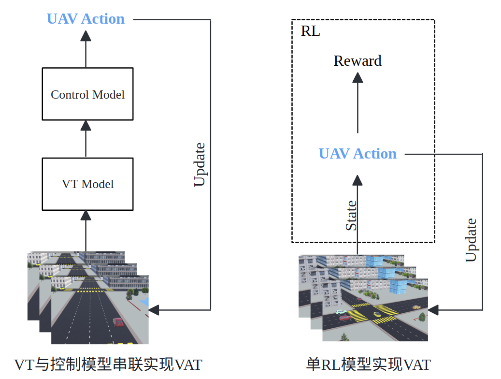
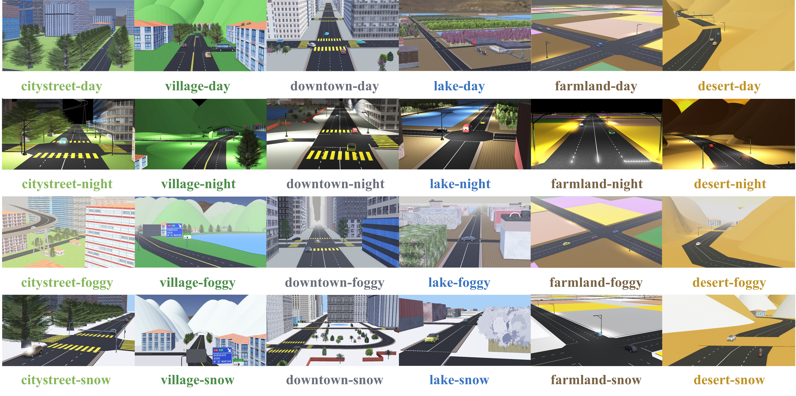

概述
=================

.. raw:: html

    

    <!-- Language switch buttons -->
    

        <b style="font-size: 18px;">You can choose language by </b>
        <button onclick="switchLanguage('zh')">中文</button>
        <button onclick="switchLanguage('en')">English</button>
    

    
     
    

     
     

1 主动视觉跟踪
------------------------------------

VAT 任务
~~~~~~~~~~~~~~~~~~~~~~~~~~~~~~~~~~~~

* **现实任务**：现实视觉任务，目标具有高动态特性，主动控制相机以提升视觉准确率是主要挑战。
* **现有方法**：现有 *PVT* (*Passive Visual Tracking*)方法基于目标在预设镜头内的假设，仅在视频维度进行跟踪。
* **VAT任务**： *VAT* (*Visual Active Tracking*)同时建模视觉跟踪和控制，做到主动控制相机以追踪动态目标，更具现实意义。

.. figure:: ./_static/image/VisualActiveTracking.png
   :alt: Visual Active Tracking
   :width: 600px
   :align: center

   **VAT** 任务与 **PVT** 设定区别

.. raw:: html

     
    

     
     

VAT 方案
~~~~~~~~~~~~~~~~~~~~~~~~~~~~~~~~~~~~

* **现有VAT方案**: 直接串联VT模型与控制模型进行 *VAT*，比如(*siamask+PID*)

   **局限1**: 视觉模型需要大量人力进行标签批注

   **局限2**: 控制模型对于参数敏感，需要对于每个不同场景进行参数微调

* **本项目 VAT 方案**: 利用 *MDP* (*Markov Decision Process*)同时对于视觉与控制任务进行建模，用单模型解决视觉与控制任务

   **优势**：端到端RL效率更高、更适合跨场景任务

   VT串联控制模型 与 单RL模型 实现 VAT 示意图

2 Benchmark呈现
------------------------------------

复杂多样仿真环境
~~~~~~~~~~~~~~~~~~~~~~~~~~~~~~~~~~~~

* **多样性**：

   * **场景多样**：具备 **6种场景** **4种天气** 共计 **24** 种环境

   * **Target多样**：预设 **24种** 可选target,支持自主模型接入

   * **任务多样**：具备 **6种** 常见视觉和运动传感器

* **复杂性**：

   * **场景元素复杂**：场景元素复杂，覆盖包括树遮挡, 隧道,红绿灯,人行道等常见场景元素

   * **动力学模型复杂**：利用 **webots** 高度仿真的动力学引擎，实现仿真环境中的动力学模拟

   * **Target行为管理复杂**：接入交通仿真器 **SUMO** 以统一管理车辆， 确保环境中的 Target 动作的 **真实性** 和 **随机性**

场景详见： :ref:`环境介绍`
追踪目标对象详见：:ref:`追踪对象`

   24个复杂场景例图

.. figure:: ./_static/image/24Target.png
   :alt: 24 Targets
   :width: 600px
   :align: center

   24种不同的Targets

.. raw:: html

     
    

     
     

State多样性
~~~~~~~~~~~~~~~~~~~~~~~~~~~~~~~~~~~~

* **多样性**：状态提供了现实中常见的传感器，如IMU，加速度计，陀螺仪，激光雷达等进行配置

.. figure:: ./_static/image/sensor_list.png
   :alt: Sensor list
   :width: 600px
   :align: center

   6种不同传感器

.. raw:: html

     
    

     
     
