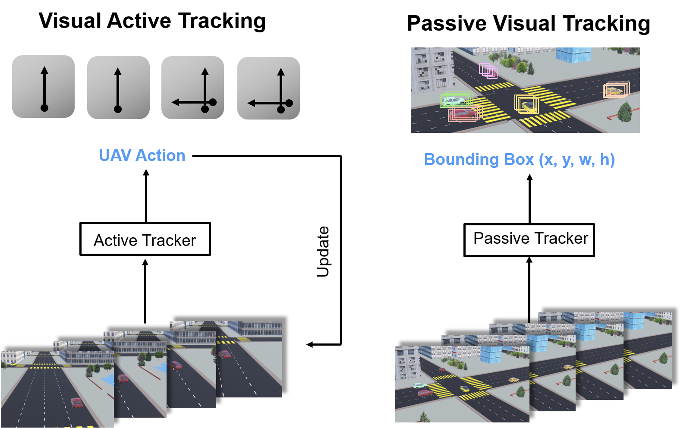
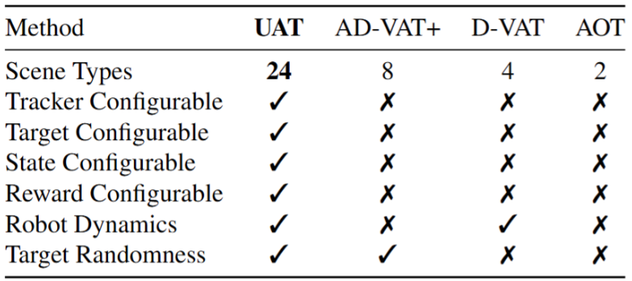
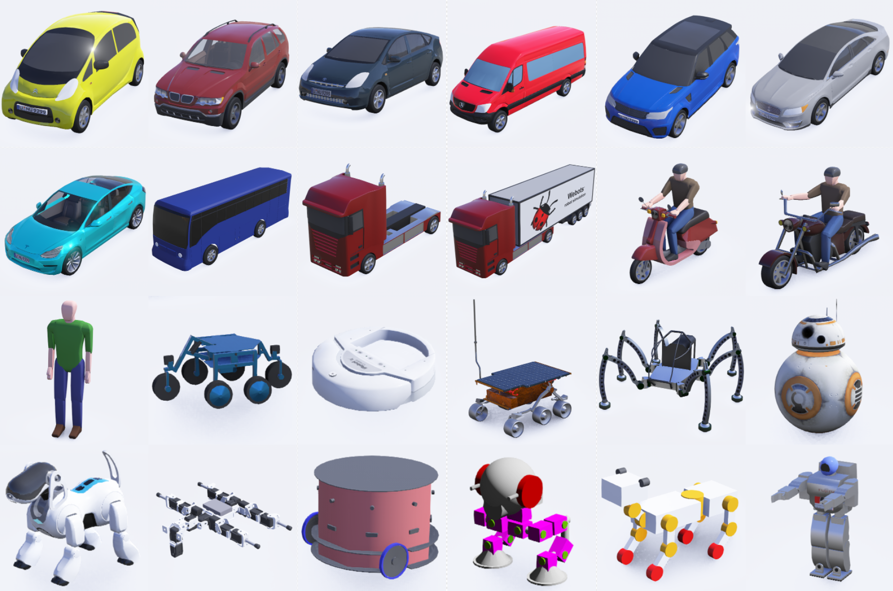

概述
=================

.. raw:: html

    

    <!-- Language switch buttons -->
    

        <b style="font-size: 18px;">You can choose language by </b>
        <button onclick="switchLanguage('zh')">中文</button>
        <button onclick="switchLanguage('en')">English</button>
    

    
     
    

     
     

1 问题定义与描述
------------------------------------

VAT 工作定义
~~~~~~~~~~~~~~~~~~~~~~~~~~~~~~~~~~~~

* **现实任务**：现实视觉任务，目标具有高动态特性，主动控制相机以提升视觉准确率是主要挑战。
* **现有方法**：现有 **PVT** (*Passive Visual Tracking*)方法基于目标在预设镜头内的假设，仅在视频维度进行跟踪。
* **VAT任务**： **VAT** (*Visual Active Tracking*)同时建模视觉跟踪和控制，做到主动控制相机以追踪动态目标，更具现实意义。

   **VAT** (*Visual Active Tracking*) 任务与 **PVT** (*Passive Visual Tracking*) 任务工作流

.. raw:: html

     
    

     
     

现有VAT方案局限
~~~~~~~~~~~~~~~~~~~~~~~~~~~~~~~~~~~~

* **现有VAT方案**: 直接串联VT模型与控制模型进行VAT，比如(*siamask+PID*)

* **局限性**：

   **1.模型串联输入延迟**: VT模型的延迟导致控制输入的滞后，甚至导致控制器发散

   **2.控制模型参数敏感**: 控制模型对于参数敏感，需要对于每个不同场景进行参数微调

.. raw:: html

     
    

     
     

基于RL实现VAT的本项目工作特点
~~~~~~~~~~~~~~~~~~~~~~~~~~~~~~~~~~~~

* **RL实现VAT项目特点**：在本次项目中使用 **RL模型** 代替原有的VT与控制模型串联，基于方针实现模型训练，具备以下特点：

   **1.RL模型替代**：利用 **MDP** (*Markov Decision Process*)同时对于视觉与控制任务进行建模，用单模型解决视觉与控制任务

   **2.仿真环境**：由于RL现实环境试错与数据采集的高昂成本，构建具备多样性(*多场景，多种tracker和target，多传感器*)、复杂性(*场景元素，target行为以及tracker动力学具复杂性*)的仿真环境进行RL训练

   不同方法仿真环境特征对比

2 Benchmark呈现
------------------------------------

本项目特点如下：

   * 仿真环境复杂多样

   * State可配置

   * Reward构建改进

复杂多样仿真环境
~~~~~~~~~~~~~~~~~~~~~~~~~~~~~~~~~~~~

* **多样性**：

   * **场景多样**：具备 **6种场景** **4种天气** 共计 **24** 种环境的测试、训练场景，用于测试模型的 *泛化* 能力与 *域泛化* 能力

   * **Target多样**：预设 **24种** 可选target,支持自主模型接入

   * **任务多样**：具备多传感器，可执行多种任务

* **复杂性**：

   * **场景元素复杂**：场景元素复杂，覆盖包括树遮挡, 隧道,红绿灯,人行道等常见场景元素

   * **动力学模型复杂**：利用 **webots** 高度仿真的动力学引擎，实现仿真环境中的复杂动力学模拟

   * **Target行为管理复杂**：接入交通仿真器 **SUMO** 以统一管理车辆， 确保环境中的 Target 动作的 **真实性** 和 **随机性**

场景详见： :ref:`环境介绍`
追踪目标对象详见：:ref:`追踪对象`

.. figure:: ./_static/image/24Scene_Colorful2.png
   :alt: 24 Scenes
   :width: 600px
   :align: center

   6种场景+4种天气构成的24种 Scenes

   24种不同的Targets

.. raw:: html

     
    

     
     

State可配置
~~~~~~~~~~~~~~~~~~~~~~~~~~~~~~~~~~~~

* **多样性**：状态提供了现实中常见的传感器，如IMU，加速度计，陀螺仪，激光雷达等进行配置

* **便捷性**：通过JSON文件快速配置

   .. figure:: ./_static/image/ParametersOfUATBenchmark.png
      :alt: ParametersOfUATBenchmark
      :width: 600px
      :align: center

      可配置参数列表

.. raw:: html

     
    

     
     

Reward构建
~~~~~~~~~~~~~~~~~~~~~~~~~~~~~~~~~~~~

   **现有方法**：

      * 利用 Target 相对于 Tracker 坐标直接构建 Reward， 如 :math:`r=A-\left (  \frac{1}{c}\sqrt{x^{2}+\left ( y-d \right )^{2}}+\lambda \left | \omega  \right |   \right )`

      .. figure:: ./_static/image/previsous_method.png
         :alt: previsous_method
         :width: 600px
         :align: center

         现有方法reward图解

   **现有方法局限性**：

      * 利用了现实中不可获取的变量，在 **Ｓim2Real** 过程中难以对于现实场景微调

   **本文方法**：
      * 仅在图像层面构建 **reward**， 如下所示情景，构建reward依照 :math:`r=tanh(\alpha(1-x)^{2}),x=\frac{l_{IP}}{l_{IE}}`

      .. figure:: ./_static/image/Continuous_reward.png
         :alt: Continuous_reward
         :width: 600px
         :align: center

         跟踪对象连续奖励示意图

   详见： :ref:`内置Reward`

3 实验方法与初步结果
------------------------------------

Experiment Setting
~~~~~~~~~~~~~~~~~~~~~~~~~~~~~~~~~~~~

   **普通实验**：比较Agent的训练和迁移性能

   **模拟Sim2Real实验**：利用DR在原场景中训练直接迁移 *vs* 在原场景训练+新场景微调 (说明reward可行性)

   .. figure:: ./_static/image/stage_compare.png
      :alt: stage_compare
      :width: 600px
      :align: center

      Stages示意图

.. raw:: html

     
    

     
     

Baseline Methods
~~~~~~~~~~~~~~~~~~~~~~~~~~~~~~~~~~~~

**Backbone**:

   **CNN+LSTM+A3C** 实现算法骨架

      * **问题1**:A3C算法的异步更新机制会导致算法快速收敛到单一动作分布，停止探索

      * **问题2**:One Stage的RL训练，智能体难理解任务

.. raw:: html

     
    

     
     

Ours: CL+PPO
~~~~~~~~~~~~~~~~~~~~~~~~~~~~~~~~~~~~

   CL：两阶段课程学习，第一阶段在视觉简单的情况下训练Agent的任务理解，第二阶段在任务理解的基础上泛化复杂视觉能力。

.. raw:: html

     
    

     
     

初步实验结果
~~~~~~~~~~~~~~~~~~~~~~~~~~~~~~~~~~~~

   .. figure:: ./_static/image/normal_experiment_result.png
      :alt: normal_experiment_result
      :width: 600px
      :align: center

      初步实验结果

4 未来工作展望
------------------------------------

时序决策
~~~~~~~~~~~~~~~~~~~~~~~~~~~~~~~~~~~~

   * **未来状态推演**：智能体在跟踪全过程对目标未来状态进行演化

   * **目标**：克服遮挡干扰，提升可解释性

   .. figure:: ./_static/image/future_work.jpg
      :alt: future_work
      :width: 600px
      :align: center

      时序决策初步构想

.. raw:: html

     
    

     
     

智能体场景与域泛化性
~~~~~~~~~~~~~~~~~~~~~~~~~~~~~~~~~~~~

   * **场景与域泛化**：智能体在跟踪全过程对目标未来状态进行演化

   * **目标**：克服遮挡干扰，提升可解释性

.. raw:: html

     
    

     
     

多传感器融合与多智能体协同
~~~~~~~~~~~~~~~~~~~~~~~~~~~~~~~~~~~~

   * **未来状态推演**：智能体实现直接的跨场景泛化和跨天气情况(域)的泛化

   * **目标**：提升跨场景跨域性能，TTA+强化学习

.. raw:: html

     
    

     
     

实机部署与迁移
~~~~~~~~~~~~~~~~~~~~~~~~~~~~~~~~~~~~

   * **真机迁移**：在真实的多场景多天气状况验证智能体的鲁棒性

   * **目标**：简化Sim2Real流程，适配多飞控部署