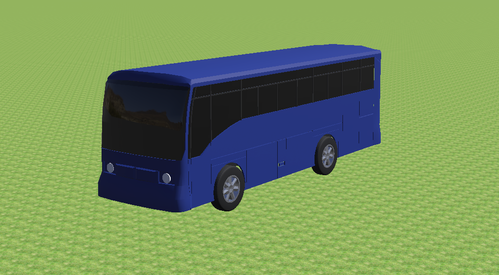
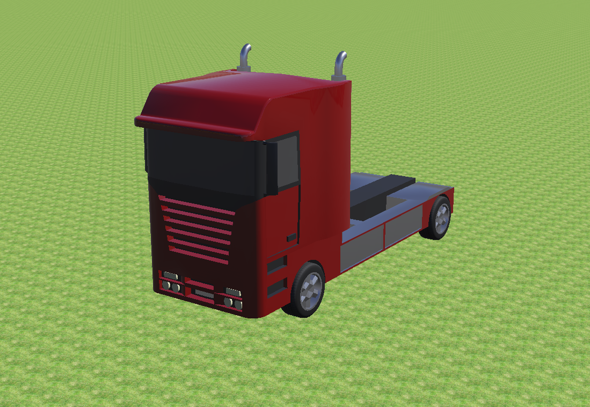
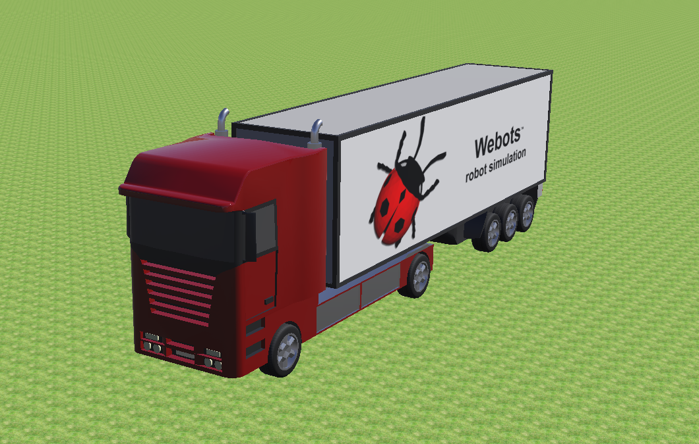

仿真环境
=======================

    .. raw:: html

        

        <!-- Language switch buttons -->
        

            <b style="font-size: 18px;">You can choose language by </b>
            <button onclick="switchLanguage('zh')">中文</button>
            <button onclick="switchLanguage('en')">English</button>
        

        
         
        

         
         

环境介绍
----------

- 该项目的仿真环境基于开源仿真软件webots搭建，仿真环境的背景是模拟现实生活中在室外场景中的目标追踪问题。为此，设立了包括城市街道、市中心、湖边、乡村、沙漠、农田共六张地图，其中每张地图演化出白天、夜晚、雾天、雪天等，总共24个环境。为了方便模型训练从简单的环境开始，还设置了几张简单的环境地图可供使用。
- 该项目24个仿真环境示意图：

   .. image:: ../_static/image/环境示意图.png
      :alt: 24个环境示意图
      :width: 600px
      :align: center

.. _运行流程:

运行流程
----------

   .. image:: ../_static/image/运行流程.png
      :alt: 仿真环境运行流程示意图
      :width: 600px
      :align: center

demo模式
~~~~~~~~~

   该模式在地图中生成一个跟踪器。可以通过键盘操作跟踪器在地图中飞行，浏览地图。同时该跟踪器默认跟踪其初始位置附近的一辆BmwX5车辆，并实时把reward参数输出在Console状态栏。可以用该对象测试内置reward参数是否合理，进行调试。

video模式
~~~~~~~~~~

   - 该模式主要用于记录被跟踪对象的行为。环境将自动调度跟踪器误差跟踪对象，并且按照仿真时间和配置参数导出视频图像，同时生成对应每张图像的标签。
   - 数据存储的位置为： :code:`./Webots_Simulation/traffic_project/droneVideos/DRONEX/episodeX` ，图像格式为jpeg，标签为 :code:`mark.json` 文件。
   - 同时还可以通过脚本生成多组视频图像的文件结构描述，直接执行 :code:`./Webots_Simulation/traffic_project/fileStruct.py` 脚本，在相同目录下生成描述文件 :code:`dir_info.json`。

train模式
~~~~~~~~~~

   该模式用于算法的训练，可以选择先手动打开webots仿真，再运行训练脚本，也可以选择通过修改算法端配置文件实现算法一键全启动。

参数配置
-----------

   仿真环境的配置文件为 :code:`UAV_Follow_Env/Webots_Simulation/traffic_project/config/env_config.json`。

基础参数
~~~~~~~~~~~

.. code:: json

   {
      "Simulation_Mode": "demo",
      "Tracker_Def": "DRONE",
      "Drone_Supervisor_Ctrl": true,
      "Socket_Ip": "127.0.0.1",
      "Config_Agen_Num_Port": 38711,
      "Train_Total_Steps": 1500,
      "Init_No_Done_Steps": 100,
      "No_Reward_Done_Steps": 100,
      "Control_Frequence": 125,
      "Customized_Rewards": true,
      "Lidar_Enable": false,
      "Tracking_Object": "SUMO_VEHICLE",
      "Verbose": false
   }

**参数说明**

   * :code:`Simulation_Mode` ：仿真模式有三种:"demo"、"video"、"train"。demo与video模式是仿真端自运行的模式（默认demo）。

      * demo会在地图中生成一个跟踪器，支持键盘直接控制，同时默认追踪地图中一辆静置车辆Bmx，可以通过该模式浏览地图或者调试reward参数。
      * video模式是视频拍摄模式，在该模式下跟踪器会自动跟踪目标对象，导出视频图像和标签。
      * train是训练模式，仿真端与算法端进行交互，对跟踪器的追踪算法进行训练。
      * 完整系统运行流程图见： :ref:`运行流程` 

   - :code:`Tracker_Def` ：选择什么跟踪器，当前的选择参数有无人机（“DRONE”）以及车（“CAR”）。其中，无人机是一个仿真无人机跟踪器，带有物理属性检测和约束，相比之下，车被认为是一个理想的跟踪器，不考虑自身物理属性，能够在任何情况下执行任何动作。
   - :code:`Drone_Supervisor_Ctrl` ：是否使用supervisor控制跟踪器，supervisor是webots的超级管理员，可以直接控制任何节点。如果为true，则使用supervisor控制跟踪器，其所有的动作都是实时无差响应的，这有利于简化算法的训练。如果为false，则使用传统PID控制器控制跟踪器的运动。该参数仅适用于无人机跟踪器，车跟踪器永远都使用supervisor进行控制。
   - :code:`Socket_Ip` ：socket通信的ip地址，如果为本机通信，默认 **"127.0.0.1"**。
   - :code:`Config_Agen_Num_Port` ：配置socket通信端口，该端口用于与算法端进行通信，以确定将要设置的跟踪器（智能体）数量。
   - :code:`Train_Total_Steps` ：训练的最大步长数，如果步长超出则返回done。
   - :code:`Init_No_Done_Steps` ：初始化没有done的仿真步长数，为了防止跟踪器在初始化的时候物理属性不稳定导致done状态的触发，因此需设置该参数在合理大小内。
   - :code:`No_Reward_Done_Steps` ：连续reward为0时产生done状态的仿真步长，有利于提高训练效率。
   - :code:`Control_Frequence` ：控制算法控制频率。在进行训练时仿真端根据仿真时间固定执行500Hz的控制频率，该参数用于调整算法端的平均控制频率。

   * :code:`Customized_Rewards` ：是否启用定制化reward参数。用户可以根据定制化reward参数，自行计算reward。

      * 定制化Reward参数的详细内容见： :ref:`定制化参数接口` 
   * :code:`Lidar_Enable` ：是否启用雷达点云数据。

      * 雷达点云数据的详细内容见： :ref:`定制化参数接口` 
   * :code:`Tracking_Object` ：被跟踪对象设置（默认SUMO_VEHICLE）。可以使用示例跟踪对象，包括“SUMO_VEHICLE”、“Pedestrian”、“Shrimp”、“Create”、“Sojourner”、“Mantis”等等。也可以自定义跟踪对象。项目说明书
      
      * 追踪对象类型的具体描述见： :ref:`追踪对象` 

   * :code:`Verbose` ：使能日志记录。如果设置为true，则会在webots终端窗口打印部分重要参数，可供使用者观察。同时在 :code:`Webots_Simulation/traffic_project/logs` 文件夹下产生程序运行日志，这部分多用于调试仿真环境。

      .. image:: ../_static/image/webots日志输出.png
         :alt: webots日志输出（“train”&“video”）
         :width: 500px
         :align: center

      * :code:`id` ：跟踪器的名称。
      * :code:`done` ：是否返回done。
      * :code:`reward` ：当前reward大小。
      * :code:`count` ：steps的步数记录。
      * :code:`time` ：仿真时间。
      * :code:`carDir` ：被跟踪目标运动方向。
      * :code:`pitchAngle` ：摄像头pitch轴角度。
      * :code:`doneState` ：产生done的原因，包括“height”（跟踪器高度不合理），“distance”（跟踪器目标位置和实际位置误差过大），“velocity”（跟踪器运动速度不合理），“yaw velocity”（跟踪器绕竖直方向旋转速度不合理），“pitch or yaw angle”（跟踪器姿态不合理）。

跟踪器（仅无人机有效）产生done的物理范围参数配置
~~~~~~~~~~~~~~~~~~~~~~~~~~~~~~~~~~~~~~~~~~~~~~~~

.. code:: json

   "Done_Range": {
        "max_height": 50,
        "min_height": 2,
        "velocity": 100,
        "omiga": 6.283,
        "roll": 1.22,
        "pitch": 1.22,
        "distance_error": 50
   }

**参数说明**

   - :code:`max_height` ：跟踪器最大飞行高度（m）。
   - :code:`min_height` ：跟踪器最小飞行高度（m）。
   - :code:`velocity` ：跟踪器最大飞行速度（m/s）。
   - :code:`omiga` ：跟踪器最大飞行角速度（rad/s）。
   - :code:`roll` ：跟踪器最大飞行roll角度（rad）。
   - :code:`pitch` ：跟踪器最大飞行pitch角度（rad）。
   - :code:`distance_error` ：跟踪器期望位置和当前位置的最大误差（m）。

内置reward的参数配置（仅无人机有效，车默认返回reward=1）
~~~~~~~~~~~~~~~~~~~~~~~~~~~~~~~~~~~~~~~~~~~~~~~~~~~~~~~~

.. code:: json

   "Reward_Config": {
        "reward_type": "view",
        "reward_mode": "continuous",
        "reward_cut_off": 0.001,
        "distance_scale": 0.01,
        "distance_range": 7,
        "view_scale": 4,
        "view_range": 0.7
   }

**参数说明**

   - :code:`reward_type` ：reward的类型（默认view）。view是按照摄像头视角投影到地面的四边形进行检测，而distance是按照摄像头视角中点投影点到目标的距离进行检测。
   - :code:`reward_mode` ：默认reward的模式。continuous产生的是[0，1]之间的连续浮点数 ，而discrete产生的是0或1的整数。
   - :code:`reward_cut_off` ：奖励截断。当获得的奖励小于这个值时，:code:`No_Reward_Done_Steps` 开始计数。
   - :code:`distance_scale` ：距离比例（默认continuous）。该参数只对continuous模式有效，控制reward因距离误差而衰减的速度。
   - :code:`distance_range` ：产生reward的距离误差范围。

   * :code:`view_scale` ：视角比例。该参数只对continuous模式、view类型有效，控制reward距视角中心误差而衰减的速度。
      
      * 具体参数含义见： :ref:`内置Reward` 
   
   - :code:`view_range` ：产生reward的视角范围。该参数用于缩放计算reward所用的四边形，也就是摄像头画面中四边形框的大小。一般设置范围为[0,1]。

SUMO交通系统参数配置
~~~~~~~~~~~~~~~~~~~~~~~~~~~~~~~~~~~~~~~~~~

.. code:: json

   "Sumo_Params": {
        "rou_update": false,
        "max_sumo_car": 40,
        "fixed_car_group_num": true,
        "car_group_num": 5,
        "car_import_interval": 52.0,
        "car_type": "passenger",
        "fixed_color": false,
        "normalize_color": [1,0,0],
        "max_car_speed": 20,
        "max_car_accel": 25,
        "max_car_decel": 25,
        "max_rou_distance": 7000,
        "min_rou_distance": 500,
        "route_num": 100000,
        "fixed_seed": false,
        "random_seed": 1
   }

**参数说明**

   - :code:`rou_update` ：交通模拟路径文件是否更新，如果希望获得确定的路径，请设置为false。 **注意：** 该模块的所有参数改动都会导致路径自动刷新。
   - :code:`max_sumo_car` ：地图中最大载具数量。
   - :code:`fixed_car_group_num` ：是否自定义每组加入环境中车辆的数量。
   - :code:`car_group_num` ：自定义每组加入环境中车辆的数量。 **注意：** 在训练和视频模式下如果该参数设置不合理（＜Agent数量*3），系统会自动设置合理的参数（＝Agent数量*3），否则环境无法稳定运行。
   - :code:`car_import_interval` ：加入地图每组载具的间隔时间（s）。

   * :code:`car_type` ：载具的类型（默认passenger），包括“passenger”、“bus”、“truck”、“trailer”、“motorcycle”。

      * 所有支持的载具类型见： :ref:`SUMO_VEHICLE`

   - :code:`fixed_color` ：是否固定载具颜色。
   - :code:`normalize_color` ：归一化的RGB颜色向量。
   - :code:`max_car_speed` ：最大载具移动速度（m/s）。
   - :code:`max_car_accel` ：最大载具加速度（m/s^2）。
   - :code:`max_car_decel` ：最大载具减速度（m/s^2）。
   - :code:`max_rou_distance` ：最大路径长度（m）。
   - :code:`min_rou_distance` ：最小路径长度（m）。
   - :code:`route_num` ：路径最大数量（注意是最大， :code:`obj_edge_distribution_multilateral` 实际由于随机化的过程不一定完全成功，会比设置的参数要少）。
   - :code:`fixed_seed` ：是否使用固定的随机种子，如果希望获得稳定的路径和车辆样式，请设置为true。
   - :code:`random_seed` ：固定的随机种子。

其他对象追踪的参数配置
~~~~~~~~~~~~~~~~~~~~~~~~~~~~~~~~~~~~~~~~~~
只有 :code:`Tracking_Object` 非“SUMO_VEHICLE”时生效。

.. code:: json

   "Other_Params": {
        "max_obj_num": 10,
        "obj_import_interval": 0.5,
        "import_group_num": 4,
        "obj_edge_distribution_random": false,
        "obj_edge_distribution_multilateral": false,
        "obj_edge_distribution_fixed": 0,
        "obj_edge_distribution_max":10,
        "obj_edge_distribution_min":-10
   }

**参数说明**

   - :code:`max_obj_num` ：最大对象数量。
   - :code:`obj_import_interval` ：每组对象加入地图的时间间隔（s）。
   - :code:`import_group_num` ：每组加入对象的数量。
   - :code:`obj_edge_distribution_random` ：是否使能对象沿着地图道路两旁随机分布。true，则会在随机路径随机位置的垂直方向随机放置。false，则会在随机路径的随机位置垂直方向固定距离放置。
   - :code:`obj_edge_distribution_multilateral` ：是否使能双边分布。true，则分布范围为 :code:`[min, max] ∪ [-max, -min]` 。false，则分布范围为 :code:`[min, max]` 。
   - :code:`obj_edge_distribution_fixed` ：距离道路中心固定的距离（m）。
   - :code:`obj_edge_distribution_max` ：距离道路中心最大的距离（m）。
   - :code:`obj_edge_distribution_min` ：距离道路中心最小的距离（m）。

输出视频的参数配置
~~~~~~~~~~~~~~~~~~~~~~~~~~~~~~~~~~~~~~~~~~
只有 :code:`Simulation_Mode` 非“video”时生效。

.. code:: json

   "Out_Video": {
        "channels": 4,
        "fps": 50.0,
        "start_time": 1.0,
        "total_time": 50.0,
        "warm_up_steps": 30,
        "output_car_dir": false,
        "random_action": true,
        "forward_speed":40,
        "backward_speed":-40,
        "left_speed":40,
        "right_speed":-40,
        "cw_omega":2,
        "ccw_omega":-2
   }

**参数说明**

   - :code:`channels` ：视频通道数量，也就是导入地图中的跟踪器数量。
   - :code:`fps` ：根据仿真时间计算的每秒帧数（按照该帧数导出视频图像）。
   - :code:`start_time` ：视频开始导出的仿真时间（s）。
   - :code:`total_time` ：视频持续的仿真时间（s）。
   - :code:`warm_up_steps` ：reset过后一开始多少个step不输出任何数据，注意，每个step的周期为2ms。
   - :code:`output_car_dir` ：是否输出车辆方向，如果使能，则只输出车辆运动方向，否则，输出reward和action。（车辆方向：0停止，1直行，2左转，3右转）
   - :code:`random_action` ：跟踪器是否使用随机动作，如果使能，则根据Control_Frequence输出随机动作，否则，跟踪器将无差跟随车辆，此时输出action为-1（无意义）
   - :code:`forward_speed` ：跟踪器随机动作的前进速度（m/s）。
   - :code:`backward_speed` ：跟踪器随机动作的后退速度（m/s）。
   - :code:`left_speed` ：跟踪器随机动作的左移速度（m/s）。
   - :code:`right_speed` ：跟踪器随机动作的右移速度（m/s）。
   - :code:`cw_omega` ：跟踪器随机动作的顺时针旋转速度（rad/s）。
   - :code:`ccw_omega` ：跟踪器随机动作的逆时针旋转速度（rad/s）。

跟踪器控制的参数配置
~~~~~~~~~~~~~~~~~~~~~~~~~~~~~~~~~~~~~~~~~~

   此组参数用于随机化跟踪器自身的跟踪属性。

.. code:: json

   "Drone_Random_Config": {
        "start_time_bias_ms": 310,

        "view_pitch_random": false,
        "view_pitch_fixed": 1,
        "view_pitch_random_max": 1.57,
        "view_pitch_random_min": 0.7,

        "height_random": true,
        "height_fixed": 15.0,
        "height_random_max": 25.0,
        "height_random_min": 13.0,

        "direction_random": false,
        "direction_random_multilateral": false,
        "direction_fixed": 0,
        "direction_random_max": 0.1,
        "direction_random_min": -0.1,

        "horizon_bias_random": false,
        "horizon_bias_multilateral": true,
        "horizon_bias_fixed": 0,
        "horizon_bias_random_max": 3,
        "horizon_bias_random_min": 0.1,
        
        "verticle_bias_random": false,
        "verticle_bias_multilateral": true,
        "verticle_bias_fixed": 0,
        "verticle_bias_random_max": 3,
        "verticle_bias_random_min": 0.1
   }

**参数说明**

   * :code:`start_time_bias_ms` ：由于环境初始化需要时间，因此理论上设置的智能体越多，初始化的时间会越长，该参数可以整体调整初始化时间的大小。

      * **注意，总的初始化时间会根据设置智能体的数量增加而增加，比该参数设置的时间要长。**

   - :code:`view_pitch_random` ：跟踪器摄像头俯仰角随机化。

   * :code:`view_pitch_fixed` ：上述参数为false，采用该参数定义的角度。

      * 若角度＞0则为俯角，反之为仰角。
      * 在使用场景中，俯角是常态。因此仿真环境中该参数的范围限制在 :code:`[0.5, 1.57](rad)`

   - :code:`view_pitch_random_max` ：最大摄像头俯角。
   - :code:`view_pitch_random_min` ：最小摄像头俯角。
   - :code:`height_random` ：跟踪器飞行高度随机化。其余参数意义同上。
   - :code:`direction_random` ：初始视角跟踪器跟随对象方向随机化，范围 :code:`[-pi,pi](rad)`

   * :code:`direction_random_multilateral` ：是否启用双边随机化配置。
      
      * false, :code:`[min, max]` ;true, :code:`[-max, -min] ∪ [min, max]` 

   - :code:`horizon_bias_random` ：初始视角跟踪器跟踪对象水平偏移。如果后续参数为正，则对象向左偏移，如果后续参数为负，则对象向右偏移。其余参数同上。
   - :code:`verticle_bias_random` ：初始视角跟踪器跟踪对象竖直偏移。如果后续参数为正，则对象向上偏移，如果后续参数为负，则对象向下偏移。其余参数同上。

部分配置参数建议
~~~~~~~~~~~~~~~~~~~~~~~~~~~~~~~~~~~~~~~~~~

   仿真器部分的参数配置建议请参考文档： :doc:`Configuration`。
   
.. raw:: html

   To Do

.. _追踪对象:

跟踪对象
--------------------

   .. raw:: html

      

            本工程提供了18种共24个预定义的跟踪目标，并提供即插即用的接口，支持用户利用自主设计的模型和控制器。
      

.. _SUMO_VEHICLE:

SUMO_VEHICLE
~~~~~~~~~~~~~~~~~~~~~~~~~~~~~~~~~~~~~~~~~~

   SUMO_VEHICLE由SUMO交通管理系统控制地图中的交通状态，使载具在地图上按照规划的路径行驶。其中，载具的类型可以进行指定。

**passenger**

   客运小型车辆，passenger类型中包含了常见的轿车、SUV、商务车，样式如下：

   .. raw:: html

      

         <figure style="text-align: center; width: 25%;">
            
            <figcaption>BmwX5</figcaption>
         </figure>
         <figure style="text-align: center; width: 25%;">  
            
            <figcaption>CitroenCZero</figcaption>
         </figure>
         <figure style="text-align: center; width: 25%;">
            
            <figcaption>LinkolnMKZ</figcaption>
         </figure>
         <figure style="text-align: center; width: 25%;">
            
            <figcaption>MercedesBenzSprinter</figcaption>
         </figure>
      

   .. raw:: html

      

         <figure style="text-align: center; width: 33%;">
            
            <figcaption>RangeRoverSportSVR</figcaption>
         </figure>
         <figure style="text-align: center; width: 33%;">
            
            <figcaption>TeslaModel3</figcaption>
         </figure>
         <figure style="text-align: center; width: 33%;">
            
            <figcaption>ToyotaPrius</figcaption>
         </figure>
      

.. .. figure:: ../_static/image/BMWX5.png
..    :alt: BMWX5                                            
..    :width: 500px                                              
..    :align: center   

..    BmwX5

.. .. figure:: ../_static/image/CITROENCZero.png
..    :alt: CITROENCZero
..    :width: 500px
..    :align: center

..    CitroenCZero

.. .. figure:: ../_static/image/LINKOLNMKZ.png
..    :alt: LINKOLNMKZ
..    :width: 500px
..    :align: center

..    LinkolnMKZ

.. .. figure:: ../_static/image/MERCEDESBENZSprinter.png
..    :alt: MERCEDESBENZSprinter
..    :width: 500px
..    :align: center

..    MercedesBenzSprinter

.. .. figure:: ../_static/image/RANGEROVERSportSVR.png
..    :alt: RANGEROVERSportSVR
..    :width: 500px
..    :align: center

..    RangeRoverSportSVR

.. .. figure:: ../_static/image/TESLAModel3.png
..    :alt: TESLAModel3
..    :width: 500px
..    :align: center

..    TeslaModel3

.. .. figure:: ../_static/image/TOYOTAPrius.png
..    :alt: TOYOTAPrius
..    :width: 500px
..    :align: center

..    ToyotaPrius

**bus**

   统一车型，大型载客车辆

   Bus

**truck**

   统一车型，不带货箱的货车

   Truck

**trailer**

   统一车型，带货箱的货车

   Trailer

motorcycle
~~~~~~~~~~~~~~~~~~~~~~~~~~~~~~~~~~~~~~~~~~

   两种车型，摩托车

   .. raw:: html

      

         <figure style="text-align: center; width: 50%;">
            
            <figcaption>Scooter</figcaption>
         </figure>
         <figure style="text-align: center; width: 50%;">
            
            <figcaption>Motorbike</figcaption>
         </figure>
      

   

Pedestrian
~~~~~~~~~~~~~~~~~~~~~~~~~~~~~~~~~~~~~~~~~~

   行人对象会按照一定的路线和一定的速度行进，同时人体会模仿真人步态进行运动

   .. raw:: html

      

         <figure style="text-align: center; width: 33%;">
            
         </figure>
         <figure style="text-align: center; width: 33%;">
            
         </figure>
         <figure style="text-align: center; width: 33%;">
            
         </figure>
      

      
Pedestrian

Wheel Robots
~~~~~~~~~~~~~~~~~~~~~~~~~~~~~~~~~~~~~~~~~~

   轮式机器人

   .. raw:: html

      

         <figure style="text-align: center; width: 33%;">
            
            <figcaption>Shrimp</figcaption>
         </figure>
         <figure style="text-align: center; width: 33%;">
            
            <figcaption>Create</figcaption>
         </figure>
         <figure style="text-align: center; width: 33%;">
            
            <figcaption>Sojourner月球车</figcaption>
         </figure>
      

   .. raw:: html

      

         <figure style="text-align: center; width: 50%;">
            
            <figcaption>BB-8球形机器人</figcaption>
         </figure>
         <figure style="text-align: center; width: 50%;">
            
            <figcaption>FireBird6</figcaption>
         </figure>
      

Legged Robots
~~~~~~~~~~~~~~~~~~~~~~~~~~~~~~~~~~~~~~~~~~

   .. raw:: html

      

         <figure style="text-align: center; width: 33%;">
            
            <figcaption>Mantis大型六足机器人</figcaption>
         </figure>
         <figure style="text-align: center; width: 33%;">
            
            <figcaption>AiboErs7四足机器人</figcaption>
         </figure>
         <figure style="text-align: center; width: 33%;">
            
            <figcaption>BioloidDog四足机器人</figcaption>
         </figure>
      

   
   .. raw:: html

      

         <figure style="text-align: center; width: 33%;">
            
            <figcaption>Scout双足机器人</figcaption>
         </figure>
         <figure style="text-align: center; width: 33%;">
            
            <figcaption>GhostDog四足机器人</figcaption>
         </figure>
         <figure style="text-align: center; width: 33%;">
            
            <figcaption>Hoap2双足机器人</figcaption>
         </figure>
      

自定义对象
~~~~~~~~~~~~~~~~~~~~~~~~~~~~~~~~~~~~~~~~~~

   该工程支持自定义被跟踪对象，实现步骤如下：

      1. 按照一定标准建立webots使用的描述文件proto文件，其中必须必须开放到场景树的属性包括"translation"，"rotation"，"name"。描述文件存放在 :code:`UAV_Follow_Env/Webots_Simulation/traffic_project/protos`
      
      .. figure:: ../_static/image/场景树属性包.png
         :alt: 场景树属性包                                  
         :width: 600px                                              
         :align: center

         场景树属性包

      2. 可以选择编写控制器，让被跟踪对象有自主的行为
      3. 在webots的 :code:`IMPORTABLE EXTERNPROTO` 模块中载入已经建立的proto文件

      .. raw:: html

         

            

               
            

            

               
            

         

         

            IMPORT PROTO
         

      4. 把proto的名称写进安全检查文件 :code:`UAV_Follow_Env/Webots_Simulation/traffic_project/config/safetyCheck.py`
      
         .. figure:: ../_static/image/SafeCheck.png
            :alt: SafeCheck                                  
            :width: 600px                                              
            :align: center

            安全检查
      
      5. 在json配置文件中修改 :code:`Tracking_Object` 的描述，其描述应当与proto名称相同
      6. 经过上述步骤就能够使用跟踪器跟踪自定义对象

.. _内置Reward:

内置Reward
--------------------

   由于Webots中超级智能体的存在，我们可以在每个时刻获取飞机以及被跟踪小车的坐标 :code:`(xf,yf,zf)` 以及 :code:`(xv,yv,zv)` ，并根据实际摄像头的Pitch角度以及设定的摄像头FOV可以直接判断出跟踪是否成功

基本思路
~~~~~~~~~~~~~~~~~~~~

   .. figure:: ../_static/image/GetReward.png
      :alt: GetReward                                 
      :width: 600px                                              
      :align: center

      内置Reward获取示意图

   1. 首先， 需要从Webots中读出的参数有：飞机的空间坐标 :math:`[x_f,y_f,z_f]` ，被跟踪小车的空间坐标 :math:`[x_v,y_v,z_v]` ，摄像头Camera的Roll角度 :math:`\alpha` 和Pitch角度 :math:`\gamma` 以及Camera的水平视场fieldOfView :math:`FOV_{hor}`

   .. raw:: html

      

          
      

   2. 则可以根据获取图像的分辨率w*h以及Camera的水平视场计算Camera的垂直视场 :math:`FOV_{ver}` ，计算公式为： :math:`FOV_{ver} = 2*\arctan{(\tan(\frac{FOV_{hor}}{2}*\frac{height}{width}))}` ，其中先取tan再取arctan是为了将FOV限制在 :math:`[0,\pi]` 范围内
   
   .. raw:: html

      

          
      

   
   3. 因此，可以计算在当前Camera位姿下，相机FOV对应的实际x方向范围 :math:`[x_{min},x_{max}]` ，以及Camera视场对应的实际距离 :math:`FOV_{height}` ，计算公式如下：

      * :math:`x_{min} = \frac{z_f}{\tan{(\frac{FOV_{ver}}{2}+\gamma)}}`

      .. raw:: html

         

             
         

   
      * :math:`x_{max} = \frac{z_f}{\tan{(|\gamma-\frac{FOV_{ver}}{2}|)}}`
      
      .. raw:: html

         

             
         

      * :math:`FOV_{height} = x_{max}-x_{min}`

      .. raw:: html

         

             
         

      * 因此，可以根据图像中得到的检测点坐标，映射到实际的世界坐标系中

      .. raw:: html

         

             
         

   4. 在上述结果的基础上，可以得到Camera在当前位姿下对应的y方向视场范围 :math:`[y_{min},y_{max}]` ，以及实际距离 :math:`FOV_{width}`

      * :math:`y_{min} = FOV_{height}*\tan{(|\alpha-\frac{FOV_{ver}}{2}|)}`

      .. raw:: html

         

             
         

      * :math:`y_{max} =  FOV_{height}*\tan{(\alpha+\frac{FOV_{ver}}{2})}`

      .. raw:: html

         

             
         

      * :math:`FOV_{width} = y_{max}-y_{min}`

      .. raw:: html

         

             
         

      * 因此可以根据图像中检测点的y坐标映射到实际的坐标系中

      .. raw:: html

         

             
         

   5. 因此，在图像中检测到的像素坐标 :code:`[x,y]` 可以被映射为世界坐标系中的坐标点（高度为0） :code:`[x',y',z']`

      .. raw:: html

         

             
         

      
   6. 对于小车在斜坡上的情况，如下图所示：

      .. figure:: ../_static/image/GetReward2.png
         :alt: GetReward2                               
         :width: 600px                                              
         :align: center

         小车在斜坡情况内置Reward获取示意图

      * 依然可以按照之前的方案进行计算，但是斜坡应该仅和x或和y有关，不应该有弯曲的斜坡，否则很难进行判断
         
         .. raw:: html

            

                
            

         
      * 实际上，由于webots接口足够完善，只需要知道跟踪器什么时候在观察斜坡即可，斜坡可以有一定的复杂性（但每一段必须是平面，不能是曲面）。

投影可视化
~~~~~~~~~~~~~~~~~~~~

   按照上述原理实现之后效果如下视频：

   .. raw:: html

      <video width="640" height="360" controls>
         <source src="../_static/video/GetReward_Video.mp4" type="video/mp4">
         Your browser does not support the video tag.
      </video>

   .. raw:: html

      

         注意：视场角上限不能超过地平线，否则计算结果没有意义。
      

.. raw:: html

    

如何转化为Reward
~~~~~~~~~~~~~~~~~~~~

1. 用于计算reward共有两个变量：

   a. 仿真环境中被跟踪目标在地面坐标系中的实际位置，由Supervisor获得，记为P1
   b. 仿真环境中跟踪器摄像头视平面的期望跟踪点，投影到地面坐标系的二维位置，记为P2

2. 首要目标是实现跟踪器tracking，是否正确tracking是获得奖励的前提。若P1与P2满足最基本的tracking要求，即可获得奖励值1，否则，直接消除所有奖励，输出奖励0。使用阶跃函数实现：

   .. figure:: ../_static/image/阶跃函数.png
      :alt: 阶跃函数                                  
      :width: 600px                                              
      :align: center

      阶跃函数示意图

.. raw:: html

    

3. 次要目标是跟踪器tracking得更好。因此P1与P2之间的接近程度可以作为奖励的惩罚项。接近程度越低惩罚越大。惩罚项使用正切双曲线函数实现： :math:`tanh(x)=\frac{e^{x}-e^{-x}}{e^{x}+e^{-x}}`

   .. figure:: ../_static/image/双曲正切函数.png
      :alt: 双曲正切函数                                  
      :width: 600px                                              
      :align: center

      双曲正切函数示意图

.. raw:: html

     

4. 最终的奖励计算框图如下：

   .. figure:: ../_static/image/distance奖励框图.png
      :alt: distance奖励框图                                  
      :width: 600px                                              
      :align: center

      distance奖励框图 

   .. raw:: html

       

   .. figure:: ../_static/image/view奖励框图.png
      :alt: view奖励框图                                  
      :width: 600px                                              
      :align: center

      view奖励框图 

.. raw:: html

    

.. _定制化参数接口:

定制化参数接口
--------------------

输入动作
~~~~~~~~~~~~~~~~~~~~

   输入动作用于控制跟踪器的运动，目前跟踪器有四个动作，前进，后退，左移，右移，加上reset数据共5个浮点数

返回参数
~~~~~~~~~~~~~~~~~~~~

   返回参数主要包括三个部分，基础数据包，自定义奖励数据包，雷达数据包

**基础数据包**

   基础数据包共22个浮点数，如下所示：

   .. code:: c++
      
      typedef struct _Odometry{
        double t;// 仿真步数（不是仿真时间）
        vector3 position;//三轴位置m
        vector3 linear;//三轴线速度m/s
        vector3 acc;//三轴加速度m/s^2
        vector3 angular;//三轴角速度rad
        vector4 orientation;//四元数
        vector3 angle;//欧拉角
        double reward;//reward
        double done;//是否结束仿真
      }Odometry;

**自定义奖励数据包**

   自定义奖励数据包共51个浮点数+1个字符串，包括以下部分

   .. code:: c++
      
      typedef struct _rewardData{
        double cameraWidth;// 图像宽度（像素）
        double cameraHeight;// 图像高度（像素）
        double cameraFov;// 摄像头视场角（rad）[0,pi`    ]
        double cameraF;// 摄像头焦距估算（像素）
        double T_ct[16];// 摄像头相对于世界坐标系的齐次变换矩阵
        double T_tw[16];// 车辆相对于世界坐标系的齐次变换矩阵
        vector3 cameraMidGlobalPos;// 摄像头中心映射到地面在世界坐标系下的三维坐标
        vector3 carMidGlobalPos;// 车辆中心在世界坐标系下的三维坐标
        vector3 cameraMidPos; // 摄像头中心世界坐标系的坐标
        vector4 carDronePosOri; // 车辆中心在跟踪器坐标系下的1D姿态+3D坐标（第一个元素是姿态）
        double crash; // 跟踪器是否与建筑物碰撞
        double carDir;// 车辆运行方向(0停止，1直行，2左转，3右转)
        std::string carTypename;// 对象类型
      }rewardData;

   - 其中，参数 :code:`carCameraPosOri` 中跟踪器坐标系定义和姿态角定义如下：
   
   .. figure:: ../_static/image/无人机坐标系.png
      :alt: 无人机坐标系                                  
      :width: 600px                                              
      :align: center

      无人机坐标系定义

.. raw:: html

   To Do: 把上面这张坐标系图修改一下

**雷达数据包**

   雷达点云数据。该环境中的跟踪器搭载了RpLidarA2单线雷达，其点云数据将输出一个长度为2000的数组。

